# DKB System Map

This is the canonical, human-facing map of the complete DKB product. It is
intended to answer two questions:

1. How do all DKB components and stored objects fit together?
2. Which parts are proven, currently being hardened, or still awaiting proof?

The map describes `project-dkb` and the separate Laravel `dkb-registry`
repository as one deployable product. Detailed provider rules remain in the
[provider architecture](final-provider-architecture.md), while accepted changes
remain recorded under [architecture decisions](../decisions/).

## Snapshot

- **Map revision:** 78
- **Checked against:** DKB `development` on 2026-10-14; Registry verification below remains dated October 9
- **Committed HTTP-security checkpoint:** DKB `59b2cdc`, Registry `18123c9`
- **Committed worker-cancellation checkpoint:** DKB `46e1888`, Registry `ba6b3ef`
- **Active milestone:** Plugin API v3, trusted Registry recipes, multi-build
  hardening, one Runtime activation gate, and complete query audit chains
- **Release state:** private developer preview; not published or merged to
  `main`
- **Checkpoint state:** HTTP authentication and worker-confirmed compilation
  cancellation are committed. Native storage ownership and crash-safe Library
  recovery have a tested uncommitted foundation; public Linux-volume Stack startup
  and offline uninstall are connected. Individual signed DKB installation is now
  connected through CLI and Console. Docker Collection install/update shares the
  same exact signed-chain verification and atomic dependency transaction as native
  installation. Docker DKB upgrades now use the same signed installer with a
  generation guard. Online signed missing-build acquisition now delegates to the
  owning Runtime. Editable-source owner compilation, offline Pipeline preparation,
  arbitrary rebinding, volume backup/restore and migration remain implementation
  boundaries. The broader
  milestone remains incomplete; historical green runs do not certify later edits.

### Archive staging safety — October 14, Windows suite verified

A deterministic regression demonstrated that the old PID/time scratch filename
could overwrite and delete an already existing temporary file. Backup creation
now uses an exclusively created per-operation directory, cleans only its own
known file, and refuses unexpected directory contents. Linux archive permissions
are set before publication, checksum writes are flushed, and a racing final
destination receives the same actionable refusal as an existing backup.
The 39 focused checks pass with two Linux-only skips. The full Windows rerun
passes **938 tests, zero failures, seven skips** out of 945 (267.3s), including
the production build. The skips require Linux or Docker and are not counted as
passes. Graphify is refreshed to 679 nodes / 1,826 edges / 19 communities.
The 943-test result below is the preceding candidate. Docker still times out on
a bounded version request, so the corrected Linux proof and disposal of the
earlier synthetic snapshot resources remain unverified. Docker was not restarted
and no existing user Library was changed. Fresh Windows distribution verification
passes for this staging correction: all 15 archives install into an isolated
global prefix, CLI 0.2.0 initializes an unrelated directory, and all six provider
integrity receipts verify. Package boundaries, workspace graph, documentation and
agent-guidance checks pass. The test installation removed its own temporary root.

Docker unavailability has now blocked the corrected Linux recovery proof across
three consecutive goal turns. The implementation goal is blocked, not complete;
resume after the engine responds. Public volume restore/topology promotion and
migration, editable Docker compilation, offline Pipeline preparation, arbitrary
rebinding and the final integrated release gates remain open. No publication,
commit, user-data migration or unrelated-container restart was performed here.

### Public volume backup integration — October 13, preceding candidate

`stack backup` now selects native host archives or recorded Docker-volume
snapshots without opening Linux databases from Windows. The existing private
Docker transport supports bounded binary output with backpressure, separate
stderr, cancellation and confirmed cleanup. Snapshot workers use a matching image
protocol, validate volume ownership labels, and read only the trusted host Stack
configuration path. Both sides validate the archive; promotion refuses an existing
output. Volume-backed upgrades remain blocked because their restore/rollback
topology integration is still unfinished.

The first rebuilt image completed public human/JSON backups, active-consumer
refusal and overwrite protection. Its staged-restore verification caught tar's
umask changing Windows-projected regular-file modes (0777 to 0755). The no-follow
descriptor correction and regression test are implemented but their Linux rerun
is pending. Docker stopped responding during disposal of that synthetic proof;
its labelled resources need confirmed cleanup before another run. No original
Library or unrelated container was changed. This is not a green recovery gate.

Six binary-stream tests pass, including an 18 MiB payload, bounded buffering,
cancellation, timeout and write failure. Backup destinations reject dot-prefixed
children and linked-parent aliases as well as existing archives/checksums.
TypeScript/Vue checks and production build pass. Broader tests caught eager
snapshot imports loading SQLite before CLI warning initialization; snapshot
contracts now load only when that worker is selected. The corrected full Windows
suite passes **936 tests, zero failures, seven skips** out of 943 (276.4s).
The skips are four Docker service proofs, two Linux metadata/link checks and the
Docker-dependent stopped-Stack check; Docker was unavailable, so they are not
counted as passes. Boundaries, dependency graph, guidance and docs checks pass.
Graphify is refreshed to 678 nodes / 1,824 edges / 19 communities. All 15 package
archives pass inspection. A fresh global Windows CLI install from those archives
initializes a Library from an unrelated directory and verifies all six providers.
These changes are uncommitted; the corrected Linux image/install/restore proof
remains open. The read-only Temp audit removed nothing; the interrupted synthetic
volume proof is intentionally retained until its Docker resources can be settled.
The preceding snapshot candidate's full run was 934 tests:
931 passed, one Windows loopback connect timeout, two Linux-only skips; the
11-test recovery-focused rerun passed without changing its expectations.

### Owner-side snapshot and staged restore — October 13, preceding candidate

The private snapshot worker now streams a checksummed file inventory and tar data
while holding native compiler, Runtime, Library and discovered nested build leases.
It uses the existing tar library, bounds compressed/expanded bytes and metadata,
and rejects changed files, unknown entries, outside links and ownership conflicts.
Restoration verifies the complete archive before touching empty staging, checks
each entry again during extraction, and verifies restored bytes and Linux metadata.
It never promotes a Stack binding or deletes original storage.

Twelve focused tests pass on Linux, including contained link chains, hard links,
service-owned files, cancellation, corruption and nonempty-target refusal. The
six-stage Docker-volume proof streams Linux SQLite/source/cache fixtures through
a Windows archive into separate Linux volumes and confirms original and restored
data independently. It also proves competing native ownership blocks snapshots
and a wrong checksum leaves staging empty. This is **not** a full Stack restore or new packaged-image
proof: current compiled code is mounted read-only into the preceding candidate.
Reproduce with `node tests/stack-volume-snapshot-proof.mjs --run`.

At this checkpoint public volume dispatch was not connected. Public backup
integration is described above; shared-Library replacement policy, recoverable
restore topology promotion and explicit migration remain unfinished. The 922-test
result below predates both snapshot and backup-integration code.

### Shared-storage backup prerequisites — October 13, preceding candidate

The stopped-state gate now checks all exact recorded volumes, including consumers
in other Compose projects. Created, running, paused, restarting and removing
containers block the operation; storage/environment drift and unknown Docker
metadata fail closed. DKB does not stop those other consumers. A three-stage real
Windows/Docker proof verified independent created/running/paused consumers,
admission after confirmed stop, and unchanged topology. Its labelled resources
were removed; no user resource was changed.

Legacy host archives now reject volume descriptors and every declared volume
before restoring configuration. A valid native archive can still recover missing
native Library/Runtime directories; missing archive payload preserves the old
Stack. Current full-candidate Windows validation passes **922 tests, zero failures
and zero skips** (380.6s), with the real Evidence and Meilisearch opt-ins enabled.
The 20 focused recovery/control checks also pass on Windows and Linux; Linux
mounts the current compiled CLI read-only into the preceding proof image, rather
than claiming a new published image. Boundaries, dependency graph, guidance and
documentation checks pass. Graphify is refreshed to 644 nodes / 1,714 edges /
18 communities. All 15 distributable archives pass inspection; fresh global CLI
installs from unrelated Windows and Linux directories initialize successfully and
verify all six provider bundles. TypeScript/Vue checks pass. Nothing was published
and the separate Registry checkout was not modified by this boundary.

This is a preflight, not a snapshot lock or completed volume backup. Volume
export/restore must retain owner-side exclusion throughout copying, validate the
complete archive, and support recoverable promotion before this release boundary
can close. The known shared-Library case must not be reduced to checking one
Stack's Compose labels. Reproduce the bounded consumer proof with
`node tests/stack-backup-consumer-proof.mjs --run`.

### Runtime-owned Pipeline preparation — October 13, preceding candidate

```text
Host CLI / Console                 Owning Runtime (native, Docker or remote)
  authenticated catalog request ──▶ read Library + Runtime under native leases
  ◀─────────────────────────────── coverage + exact state/profile receipt
  each pinned Registry origin
    → saved host login
    → exact signed build grant
  preparation + grants ───────────▶ recheck selection, Library and recipe
                                    → download and verify signed missing layers
                                    → prepare indexes → atomic activation
```

The host never opens a Docker/remote state path. Saved Registry credentials remain
on the host, and an environment bearer is used only for its explicitly matched
origin. Each package keeps its Registry origin; the Runtime's Stack Registry URL
no longer redirects all Pipeline downloads. Existing catalog, grant, signed-build
and activation services are reused, with no new database or management endpoint.
Missing builds are distinct from invalid retained builds. Preparation conflicts
preserve the previous activation and now retain a structured CLI error code.
Registry layer errors discard untrusted response bodies rather than echo grants.

Verified on this candidate: TypeScript/Vue checks and production build; full
Windows suite **910 passes, zero failures, three opt-in service skips** (432.1s);
**33 packaged Linux tests with zero failures/skips**; and a five-stage real
Windows CLI/Console → Linux-volume Runtime proof. The latter checks corrupt/refused
downloads, exact signed acquisition, stale preparation, retained-build reuse,
redacted Activity, offline failure without host fallback, and restart persistence.
It uses a synthetic signed HTTP Registry, not Laravel or a model benchmark.
Its container/volume were removed and no existing user resource changed.
The candidate image is
`741707259302957afff50344f7964e8247b042dd4551d1e205616844014126ca`.
Boundaries, dependency graph, 18 guidance scopes and 36 documentation files pass;
Graphify records 641 nodes / 1,697 edges / 20 communities.
The three opt-in services were then explicitly enabled: **64 service tests pass,
zero failures/skips** (143.5s), including real Evidence worker/service and
Meilisearch checks. All **15 archive inspections** pass, and fresh global CLI
installs from unrelated Windows and Linux directories verify all six providers.
The read-only Temp audit still lists the same 32 preceding entries; no cleanup
of unrelated files was performed.

Reproduce the bounded owner handoff with
`node tests/runtime-pipeline-owner-proof.mjs --run` after rebuilding the matching
CLI image. Editable Docker/remote DKBs with missing builds require compilation in
their owning environment; this host path refuses to compile them or open their
database. Offline Pipeline preparation, arbitrary Runtime rebinding, volume-aware
backup/restore and copy-and-verify migration remain active release boundaries,
followed by the complete Stack, real-corpus, performance and ChatGPT proofs.

### Managed-index retention and reconciliation — October 13, preceding candidate

Managed imports now write immutable Runtime-owned retention receipts before
external provider side effects. Successful activation triggers reconciliation
outside its preparation transaction: for each recorded Library, acquire native
mutation ownership, verify applied state, and remove only absent package versions.
Installed releases retain every recorded space, including inactive Pipelines;
another Runtime's activation is never rewritten. Retry records survive failed
cleanup. Invalid records, changed recipes/options and changed resolved backing
stores grant no cleanup authority. CLI/Console distinguish maintenance warnings
from genuinely stale Runtimes.

Managed API v3 providers now supply `storageIdentity`, a credential-free digest
of the resolved service/store and tenant/namespace. The SDK, scaffold, conformance
suite and bundled managed provider share this contract. It is operational state,
not retrieval compatibility. Exact-index preparation rollback also checks this
identity. No new service or database was added; obsolete direct cleanup calls
were removed from package lifecycle handlers.

That preceding candidate verification passed: all TypeScript/Vue checks and production
build; **898 Windows tests, zero failures or skips, in 368.3 seconds**, including
both real Docker Evidence checks and the new disposable Meilisearch proof; 74
packaged Linux trust/lifecycle/recovery tests plus six managed-index tests, with
no failures or skips; and the nine-stage live Windows-to-Linux CLI/Console proof.
The Linux lifecycle image is
`5a1b3bcab46e9e1a18ea889d69d42fdd3dbdd5b65af0b70bac2a74cc77cbc97d`.
All 15 archive inspections and fresh isolated global CLI installations pass on
Windows and Linux, each verifying all six shipped providers. The image file-policy
inspection covers 937 product files, excluding dependency trees. Package boundaries,
the dependency graph, 18 AGENTS scopes, 36 documentation files and whitespace
checks pass. Graphify records 638 nodes / 1,694 edges / 20 communities.
The final read-only Temp audit retains the same 32 pre-existing DKB entries;
it deletes nothing. This checkpoint's labeled managed-index and Library proof
containers/volumes are absent after cleanup.

The Meilisearch proof exercises two Libraries, retained spaces, cleanup isolation
and reactivation from unchanged builds; fixture Evidence and embeddings are not
a model-quality or performance benchmark. The live CLI/Console proof uses signed
HTTP fixtures, not the Laravel Registry or a browser interaction. These results
do not substitute for the remaining real-corpus, performance and full-stack gates.
Older untracked indexes
require provider-side inspection; DKB does not infer deletion authority from
service inventory. At that checkpoint the broader release boundaries were
Linux-owned missing-build acquisition, arbitrary Runtime rebinding, volume backup/restore
and migration, followed by refreshed complete Stack and real-corpus proofs.

### Library destination authority — October 13, preceding candidate

Native `install`, `upgrade` and `uninstall` now use the selected Library rather
than redirecting mutation to an explicit Runtime endpoint. Runtime URLs request
post-commit refresh only, matching Docker and Collection behavior. The shared
installer, removal transaction, signature checks and upgrade-generation guard
remain authoritative; no parallel installation system was added. A failed reload
reports a stale warning without undoing a committed Library change. Dry-run,
failed verification and stale-plan rejection do not refresh anything.

The new executable regression tests first reproduced wrong-destination success
on the earlier CLI route. They now use actual
signed source/Evidence/Retrieval layers, two independent Libraries and a bounded
HTTP fixture to check the chosen destination, post-commit refresh order, exact
rollback, generation conflict and unavailable-refresh recovery. The following
older sections certify preceding candidates, not these changes.

That preceding candidate passed: all TypeScript/Vue checks and production
build; all 15 archive file inspections and fresh isolated global CLI installs on
Windows/Linux; 74 packaged Linux lifecycle/trust/recovery tests with no skips;
and the nine-stage live host-to-Linux CLI/Console proof. These use image
`b5db5a64d9c71d4c79868df38d513f17e5202dd8243bb25a5d0897eae3234298`.
The image file-policy check covers 938 product files, excluding dependency trees.
The initial full Windows run had 888 passes, three localhost connection failures
and one opt-in service skip. All 17 tests in the affected files passed in a
separate serial recheck without changing assertions or timeout limits. The full
rerun passes **892 tests, zero failures and zero skips in 356.0 seconds**,
including both real Docker Evidence tests. The
intermittent Windows connection failures are not explained by this correction.

That candidate exposed the managed-index reconciliation gap addressed above.
Its green checks did not certify managed-index reclamation. The removed
endpoint-directed package mutation route must not be restored as a cleanup path.

### Docker package upgrades — October 13, preceding candidate

`outdated` and upgrade planning read the existing owner-side package listing,
including applied version, Registry origin and generation. An explicit URL may
override origin, but changing a Library's convenience default does not redirect
an installed package. Dry-run and up-to-date results request no install grant or
artifact downloads. Registry search also uses the shared Library-handle resolver.

The fixed DKB install worker is now `dkb.library-install.v2`. It checks the
expected applied generation under the existing native writer lease, retaining
ownership through the shared signed installer. A stale plan fails before remote
acquisition. Ordinary native upgrades without a Runtime override use the same
generation guard. No second installer, database, upgrade transaction or arbitrary
command endpoint was added. Matching rebuilt CLI images are required; v1 is not
a fallback. Library listings also fence their asynchronous reads against drift.

The nine-stage live proof passes on
`sha256:9c353ce2ccfdc8fe5587219c5b4fb08d6c3e1fc0e221e93e81ec609368d6fbb7`.
It runs the actual CLI and Console command runner against disposable signed
HTTP fixtures and a Linux-local Library. It verifies install/retry/removal,
grant redaction, corruption and expiry, cancellation cleanup, exact origin despite
an offline Library default, no-download planning, Console upgrade from 1.0.0 to
1.1.0, unchanged prior knowledge on failed download, and stale-plan rejection.
It is not Laravel authentication, browser interaction or model-quality proof.

The focused Windows run passes 65 tests; the packaged Linux run passes all 64
Collection/trust/recovery/grant/transport tests, with no skips, in 74.3 seconds.
TypeScript/Vue checks and production build pass. The image file-policy check
passes for 938 product files, excluding dependency trees. Boundaries, dependency
graph, 18 AGENTS scopes, 36 documentation files and whitespace checks pass.
Graphify records 637 nodes / 1,692 edges. The full Windows run passes with
**889 passed, zero failed, one opt-in model-backed service test skipped, 890
total**, in 415.3 seconds. Real Docker fallback is enabled in that run. The
skipped service proof passes separately in 24.4 seconds on the installed
`841cc1755dea` model-baked image, including acknowledged cancellation and
unavailable-control recovery. All 15 distribution archives pass file-policy
inspection. The fresh global CLI initializes an unrelated isolated directory
on Windows and Linux, reports 0.2.0, and verifies all six shipped provider
dependency closures. The final Temp audit is read-only; no retained entries
were removed. No existing Library, Registry,
host defaults or credentials were migrated, and nothing was published.

That preceding checkpoint did not certify the native explicit Runtime route.
The destination-authority correction above removes this separate mutation path.

### Docker Collection grant delegation — October 13, preceding candidate

The host resolves an exact immutable Collection revision and obtains one scoped
install-plan grant per member. A bounded private request goes to the existing
fixed Linux CLI worker. Its transport adapter supplies plans and downloads to
the shared Collection installer; it never commits members as separate top-level
install operations. Reusable Registry login stays on the host, and Windows
never opens the Linux Library database. Protocol owns the portable request
validation; the Runtime owns installation and its outer mutation transaction.

Top-level `install`, `collection install` and explicit `collection update` use
the same route. Native and Docker installs also share post-commit Runtime refresh
handling. The Console's existing typed install operation uses this public CLI
path. Direct/shared-member protections, exact retry, receipt verification,
rollback, and explicit recovery are not reimplemented in the transport.

The six-part live proof passes again on the rebuilt Collection candidate, through
public CLI and the actual Console runner/Activity store. It covers exact retry
without artifact downloads, shared-member reuse, direct-root preservation and
update protection, expired later-member grants, cancelled-worker/scratch cleanup,
explicit journal recovery, and identical-release reinstall without compilation.
Only exact-plan grants enter Linux; the proof rejects leaked host credentials
and unexpected compilation requests. It uses synthetic signed HTTP fixtures,
not Laravel authentication, browser interaction or model-quality evaluation.

The first full Windows run exposed an eager service import: request validation
loaded SQLite before the CLI installed its output contract. All 17 failures
were warning/output regressions. Validation now resides in Protocol, with native
installation loaded at operation time. The existing 62-test CLI/recovery/routing
and Collection-grant run passes without changing warning assertions.

The rebuilt candidate
`sha256:307947db5c91c3ad81110d96e108c02c564464e3aa098d3f6e51f8f40cf58d5a`
passes all 64 packaged Linux Collection/trust/recovery/grant/transport tests in
38.7 seconds, with no skips. All 15 archives pass the distribution file-policy
inspection; the global CLI initializes an unrelated isolated directory on both
Windows and Linux and verifies all six shipped provider dependency closures.
The image's 938 product files pass inspection, excluding dependency trees.
The final production build and all TypeScript/Vue checks pass. The full Windows
rerun completes in 384.0 seconds with **889 passed, zero failed, one opt-in
model-backed service test skipped, 890 total**. The separate real Docker fallback
test is enabled and passes in that run. The skipped model-backed service proof
passes separately in 16.6 seconds on the installed `841cc1755dea` Evidence image,
including warm output, acknowledged cancellation and unavailable-control recovery.
Package boundaries, the dependency graph, 18 AGENTS
boundaries and 36 documentation files pass. Graphify records 636 nodes / 1,686
edges. No user Library, Registry data, host defaults or credentials were migrated.

The six-pair bounded regression comparison against `46e1888` also passes the
unchanged 10% limit: candidate/baseline medians are 822/1,108 ms compile,
102/105 ms search, 97/101 ms fetch and 96/104 ms insufficiency. Every valid pair
participates, and source/build identities remain identical. This is the existing
128 KiB, eight-file, 184-record synthetic MiniSearch harness, not a large-corpus
or TEI/FAISS performance claim. The complete release gate remains open.

### Collection trust prerequisite — October 13, preceding candidate

Collection installation no longer treats receipt-file presence as verification.
Protocol owns the exact immutable revision validator and the Registry-compatible
snapshot digest. Registry client reads/publication responses and Runtime admission
share it. Member plans are signature-checked and bound to snapshot identity,
version and source-tree digest before downloading any member. Unsigned release
metadata is no longer the Collection installation authority.

Retries and shared-member reuse verify source bytes, exact retained build
artifacts, receipt chains and origin-pinned keys. A retry also verifies the
installed Collection snapshot. Same-revision drift, editable-local replacement,
and cross-origin/different-digest updates fail closed. Library synchronization
preserves the origin of an unchanged release instead of replacing it with the
Library's current default. Collections remain digest-bound Registry metadata;
their member DKBs carry signatures. No new Collection signature format or Registry
data rewrite is implied.

The original five failing regression cases now pass, as does the subsequently
reproduced installed-snapshot tampering case. Synthetic tests cover corrupt
retained artifacts, Unicode digest parity with PHP, idempotent retry, origin
preservation, and rollback after a later member fails. Collection crash-recovery
fixtures now use real signed source/Evidence/Retrieval layers rather than dummy
receipt files. The existing killed-update recovery and direct-member retention
assertions remain intact.

The final production build and all TypeScript/Vue checks pass. The full Windows
suite reports **874 passed, zero failed, two opt-in Docker tests skipped, 876
total** in 401.9 seconds. The subsequently added exact-version update test passes
in a separate 13-test Collection/Registry-contract run; it was not included in
that already-running full suite. Earlier intermittent loopback failures did not
recur; this passing run does not diagnose their historical cause.

The packaged Linux candidate
`sha256:263ae9c348d79711290b7c0c18e9ced2bb7a4f24bd18aadd1127b7fda93e036b`
passes all **40** Collection, signature, Library, owner-install, and crash-recovery
checks in 32.9 seconds, with no skips. The first attempt lacked the development-only
MCP client; the harness now supplies only its missing pure-JavaScript test
dependencies read-only, without replacing image product code or production
dependencies. This proof uses Linux-local disposable storage and synthetic signed
fixtures, not Laravel or public host-to-Docker Collection routing. Its labelled
containers and volumes were removed after the proof.

All 15 archives pass inspection: six provider bundles through the full suite's
independent offline-install proof, and nine other workspaces from the same build.
The image's 935 product files pass the explicit file-policy inspection, excluding
dependency trees. Package boundaries, dependency graph, 18 AGENTS boundaries,
36 documentation files, and whitespace checks pass. Graphify records 635 nodes /
1,679 edges. The final Temp audit is read-only; no retained user or proof resources
were removed.

This is a verified prerequisite repair, not completed host-to-Docker Collection
transport. That delegation and missing-member-build acquisition remain the next
integration boundary; upgrade, verification, backup/restore and explicit migration
also remain release work. No user Library, host defaults or Registry data was
changed. The prior image/results below describe the preceding candidate only.

### Signed Docker Library installation — October 13, preceding candidate

The public host CLI obtains a signed exact-plan download grant, then runs a fixed
Linux CLI worker against the existing Library and disposable scratch volume.
Reusable Registry login stays on the host. Windows never opens the Library
database. The existing signed installer, mutation journal and Runtime refresh
orchestration remain authoritative; no new management API or database exists.
Registry resolution retains explicit/environment/Library/association/default
precedence and fails closed when required owner inspection fails.

The seven-part live proof passed on the preceding packaged CLI image
`sha256:35e51e9554cd154be2ab14452386b74dfb6390258f3f117061caf68e8e4bad76`
and host CLI/Console: signed install without a Runtime, exact retry
without artifact downloads, corrupt/expired-grant rollback, cancellation with
confirmed scratch removal, uninstall/reinstall, public CLI progress and host-only
login, and real Console runner/Activity records. This is a synthetic signed HTTP
Registry fixture, not Laravel authentication, browser UI or model-quality proof.
This image includes the public host routing and Console credential-location
repair. It also passes 117 packaged Linux tests and seven live Stack owner checks
for independent Runtime bindings, configuration rollback, process death,
cancellation and retained Library volumes. Product-file inspection passes for
929 files, excluding dependency trees. No user resource was changed.

Focused tests pass for signed-chain/expansion/download behavior (23), fixed
worker lifecycle and ordinary offline-worker regression (24), Registry precedence
(9), and the Console credential-file override (1). The latter was reproduced
failing before forwarding only the configured path, never the bearer environment
variable. The production build and all TypeScript/Vue checks pass. The full
Windows run completes in 432.3 seconds: **859 pass, three fail, two skip, 864
total**. Failures are loopback connections during initial Registry verification,
the lexical compiler HTTP proof, and native Runtime removal. All three pass in
one focused run; that does not explain or fix their intermittent full-suite
failures. No timeout, retry, assertion or product transport was weakened.
The two skipped opt-in Docker Evidence worker proofs pass in a separate explicit
run, including model-baked warm output, acknowledged cancellation and recovery.

All 15 distributable archives pass inspection: the six provider bundles through
the full suite's independent offline-install proof, plus nine non-provider
workspaces from the same completed build. Graphify now records 635 nodes / 1,679
edges. Boundary, dependency, documentation and AGENTS checks pass. The final
read-only Temp audit reports the same 32 retained DKB-prefixed entries; none were
removed. Labelled install/Stack proof containers and volumes are absent after
cleanup. The complete Windows/release gate remains red; earlier sections below
record earlier candidates, not current certification.
Docker Collection download, upgrade/verification, Pipeline acquisition, volume
backup/restore and explicit stopped-writer migration are not complete.

### Archive expansion prerequisite — October 13, before owner install routing

The shared Library extractor now applies header-level byte/entry budgets and a
conservative free-space admission check before file writes, while retaining
node-tar streaming, path/link checks and caller-owned staging cleanup. It does
not add a second decompression pass, a new archive implementation or an OS quota.
This closes a missing disk-capacity prerequisite for authenticated Docker owner
downloads; public transport was still disabled at this earlier checkpoint.

Four regression tests first reproduced the missing limits; five new budget
tests now cover the repaired boundary. All 20 focused archive,
signed-grant and download tests now pass, including low-capacity alternate-build
failure preserving source, applied state and retained builds for both Library
and Runtime destinations. The full Windows suite completed in 413.2 seconds:
**839 of 840 pass, one fails, zero skips**, with both real Docker Evidence-worker
checks enabled. This run's failure is the compiler liveness test's unchanged
one-second health request deadline. The prior recovery-refresh test passes, but
neither intermittent failure is explained. Liveness now reuses the test-only
transport observer to distinguish connection acceptance, HTTP handling and
event-loop delay on a future failure; no deadline, retry, product transport or
assertion was weakened. Both instrumented recovery/liveness cases pass in a
focused run; that is not a repair of either intermittent full-suite failure.

The current image
`sha256:3deb899d1dc5548b8880158d113e72ae7ca74514a1292bc6102308b79338cfdb`
passes **93 packaged Linux tests and seven live owner checks**, including the
new archive-budget suite. Only labelled disposable proof resources were removed;
no user resource changed. All **15 distributable archives** pass inspection:
the six provider archives in the full suite's independent offline-install proof,
plus a separate nine-workspace inspection of this same completed build. Workspace
TypeScript/Vue, production build, boundary, dependency, docs and AGENTS checks
pass. Graphify remains at 625 nodes / 1,640 edges. The final read-only Temp audit
reports the same 32 retained DKB-prefixed entries, with none removed. The complete
Windows/release gate remains red. Earlier sections below apply to earlier
candidates, not this extractor change.

### Library grant-install prerequisite — October 13

`installDkbFromLibraryGrant` and `installDkbFromRuntimeGrant` now share one
exact-plan acquisition path. The Library destination uses the existing signed
materialization and mutation services without creating or activating a Runtime.
It keeps the canonical Registry origin distinct from its transport endpoint and
passes only a download grant to artifact requests; public-key lookup does not
inherit the host bearer token. Invalid grant envelopes fail before initialization.
Retained-build reuse now compares the complete requested signed chain, including
the exact Evidence and Retrieval digests, before reporting `already_installed`.
Regression fixtures first reproduced incorrect success against the previous
implementation for both destinations; the existing exact-plan validator closes
that bypass without introducing another resolver.

Focused signing/transport tests pass for both destinations, including alternate
build acquisition without redownloading source, malformed credentials/endpoints,
tampered plans, expired grants, corrupt downloads, same-recipe/different-build
requests and preservation of previous installed state. These are synthetic
signed-layer/HTTP fixtures, not the Laravel
grant-expiry/replay proof or Docker public-install integration. The offline owner
worker has not gained network or credential access. CLI delegation, Collection
acquisition and full lifecycle remain active work. The new candidate passes
**85 packaged Linux tests and seven live storage-owner checks** on image
`sha256:58f228c952ca423b37fd34db5a7e928c3a90cb10913de0b7f01fd2c68df032c9`.
The live checks include independent Runtime bindings, configuration rollback,
cancelled/dead owner cleanup and preserved shared Library volumes. They use
only labelled disposable resources and change no user resource. Image inspection
passes for 914 shipped product files, excluding dependency trees. The final
Windows run completed in 415.9 seconds: **834 of 835 tests pass, one fails, zero
skips**, with both Docker Evidence-worker checks enabled. The recovery-refresh
case failed with the previously observed socket-level `ETIMEDOUT`. Its synthetic
server was listening and accepted no connections; maximum recorded server/client
event-loop delays were 57/621 ms. Library recovery succeeded and correctly
reported both Runtimes as stale. A separate 100-session Node-only loopback probe
then passed; that does not explain or repair the failure. No retry, connection
warmup, deadline increase or assertion change was made. All **15 distributable
archives** pass inspection on this candidate. The final read-only Temp audit
reports the same 32 retained DKB-prefixed entries and removes nothing; no protected
leftover was retried. The 834-test result below precedes this prerequisite. This
candidate's complete Windows gate is not green.

### Offline owner-side uninstall — October 13

`uninstall`/`remove` and `collection uninstall` now share `packageRemoval.ts`.
The host resolves a Library handle, invokes the same allowlisted Linux CLI and
refreshes serving Runtimes after the Library commit. It never sends a Runtime
mutation request on the Docker Library path. Explicit reload endpoints remain
host-side and are deduplicated; unavailable Runtimes produce stale warnings with
recovery instructions. An owner failure produces no reload or host-path fallback.
Native HTTP removal remains outside the CLI writer lease to avoid waiting on a
second process that needs that same lease.

The real Windows-to-Linux `library-owner-cli-proof.mjs --run` passed all twelve
checks on image
`sha256:11a69337059984a5546fa50d11562c47b86acdf35199a87943957c29bfdf0a87`.
Its new applied-state fixture proves Collection dependency rejection, retention
of directly installed members, removal of unused vendor files/builds,
preservation of editable source and one terminal event result. It grants no
network or credential to the worker and cleans only its labelled test resources.
This is not a signed-download, model-quality or full Console lifecycle proof.
The complete post-change Windows suite passes **834 tests, zero failures and
zero skips** in 359.8 seconds, including both enabled Docker Evidence-worker
checks and the native HTTP lease regression. Graphify was refreshed to 625 nodes
and 1,640 edges. All workspace TypeScript/Vue checks, production build, package
boundaries, dependency graph, documentation and AGENTS checks pass. All **15
distributable archives** pass inspection after the completed build. The final
read-only Temp audit removes nothing and reports 32 DKB-prefixed entries; the
cleanup release gate is still open. No protected leftover was retried. The earlier
broad results below cover the pre-uninstall candidate.

### Public Linux-volume Stack startup — October 13

`stack up` now uses the owner startup coordinator, rather than preparing a
Windows Library or Runtime directory. `ownedStorage.ts` persists an exact storage
intent before creating labelled local volumes; `ownedManager.ts` connects real
Compose startup, authenticated Runtime activation and host registration. The
host receives a Docker Library handle, never a fabricated filesystem path.
The distribution declares additional service volumes as inert metadata; CLI
storage orchestration contains no provider-specific storage choices.

```text
Host stack-storage.json + private stack.env
    -> fixed Linux CLI initializes Library and Runtime binding
    -> owner prepares exact recipe/image identities
    -> Compose mounts external Linux-local volumes
    -> Runtime activation gate
    -> verified owner completion -> host registration
```

The latest explicit `tests/stack-volume-startup-proof.mjs --run` run passed real
service health, activation, volume-only mounts, Docker Library registration,
host-path absence, stop/restart persistence and missing-volume rejection. This
used an empty synthetic Library, not the signed package lifecycle. It removed
only its own containers, volumes, network and temporary host catalog. Existing
user resources and defaults were not touched. The final metadata/boundary refinements
are included in this run. CLI image
`sha256:cc9df256615ce4c32d74fababa1e5ed58d74dc133afb72bfb940c88a98b3b765`
is the tested Linux management image. The missing-volume check removes only the
proof's stopped Runtime volume and confirms startup refuses to replace it.

All workspace TypeScript/Vue checks, the production build, dependency/boundary,
documentation and AGENTS checks pass. The 67 focused topology/owner/backup checks
and nine retained native-recovery checks pass. An initial broad run exposed a
stale Docker test double; it now validates the exact container-label inspection
request without weakening rollback assertions. A mistyped opt-in Evidence image
argument was corrected from Docker inspection, and its real service cancellation
proof passes. The final combined Windows run passes **826 tests, zero failures
and zero skips** in 401.7 seconds, including both opt-in Evidence Docker checks.
All **15 distributable archives** pass inspection. The same candidate passes all
**73 packaged Linux checks and seven live owner checks** in isolation, including
host process death, delayed dispatch rejection, cancellation cleanup and two
independent Runtime bindings sharing one Library. An earlier overlapping run
exceeded the unchanged suite deadline alongside Windows tests and package
inspection; that run remains a failure, not a performance fix or extra retry
inside the proof. The isolated result is recorded independently.

Existing host-mounted Stacks require explicit migration; startup neither moves
them nor creates replacements. A ready descriptor with a missing volume fails
closed. `init --if-absent` preserves an existing Library's Registry configuration.
Volume-backed backup/restore, authenticated Registry delegation, legacy recovery
tool removal and migration remain release blockers. The earlier 821-test result
below applies to its earlier candidate, not these new edits.

### Linux-owned first Runtime binding — October 13

The fixed Stack worker now admits `binding.initialize`, using Runtime's existing
atomic initializer rather than a host write or another activation implementation.
It validates the mounted Library and selected recipes, queues behind native
owners, and rejects foreign Runtime identities, wrong Library mounts and pending
configuration/activation recovery. Repeating the request preserves an existing
binding and activation, including its current Pipeline. It never changes Library
contents or Registry defaults. A new Runtime remains inactive until the normal
activation gate succeeds.

The nine focused tests pass, including process death immediately after binding
promotion. The packaged Linux proof now initializes its two Runtime volumes via
this typed operation instead of proof-only evaluated setup code. This completes
the initialization prerequisite, not public `stack up` integration. Volume
provisioning, actual Compose callbacks, registration, backups and authenticated
Registry delegation remain the next connected lifecycle boundary. Graphify is
refreshed to 602 nodes / 1,527 edges / 20 communities with no semantic-model calls.

CLI image `sha256:137a34bfbc35128624874a997e2d006f64a8d03619a939bdb407a9b85f00b381`
passes all seven Stack-owner checks, including all 73 packaged Linux tests.
The same image passes all 11 CLI/Console delegation checks, including concurrent
writers, cancellation and stopped-Runtime recovery. Both proofs removed their
labelled resources and changed no user resource. All workspace TypeScript/Vue
checks and the boundary, dependency,
documentation and agent-guidance checks pass. The full Windows suite passes
**821 tests, zero failures and zero skips**, with both opt-in Docker Evidence-worker
checks enabled. Its test phase took 334.5 seconds. The earlier intermittent
Windows transport failures did not recur, but this run is not a demonstrated fix
for them. No retries, warmups or deadline changes were added.
All 15 distributable archives pass inspection after the completed build. An
earlier inspection overlapped output cleanup and failed with a missing generated
file; that orchestration error is not counted as a packaging pass. The final
read-only Temp audit removes nothing; older retained DKB fixtures still prevent
a clean-Temp release claim.

### Owner-side Stack configuration and startup coordination — October 13

The Linux owner can now prepare and recover compiler/Runtime recipe configuration
without writing a binding, activation, Library or service. The preparation uses
the existing recipe/image-identity rules, checks the exact planned state, and
journals both prior files before either changes. Rollback preserves operator edits
and unrelated activations. A completed requested activation is retained after a
lost host reply rather than overwritten with an old snapshot.

Completion is durable before the recovery journal is removed. A bounded receipt
contains only operation/storage identity, outcome and state digests; repeated
settlement verifies the current state instead of guessing from a missing journal.
Real process-death tests cover both configuration promotions, receipt promotion
and the interval after journal deletion. These are not power-loss durability tests.

Cancellation before owner dispatch is also explicit: Linux verifies the original
observation before acknowledging that nothing changed, and rejects delayed
preparation with that cancelled operation ID. Missing journals alone still do not
mean success.

The host coordinator in `apps/cli/src/stack/ownerStartup.ts` persists the operation,
owner descriptor, before/after topology and Compose digest before dispatch. It
retains recovery through partial registration or failed service restoration, never
repeats activation on recovery, and refuses to overwrite changed operator state.
Its 26 focused Windows tests include seven real process terminations and four
redirected-folder cases. Fresh ancestor/storage checks reject Windows junctions
and Linux symlinks before dispatch and recovery, after service startup, and before
final journal removal. The checks reuse the Library storage validator without
opening a Library database. Actual
Compose callbacks and volume-backed public Stack startup are not connected yet.

Planning now returns only distribution-allowlisted public service settings, so
the host can configure the selected model/revision without receiving arbitrary
plugin options. Both ends reject secret fields, unselected services and Compose
interpolation. Preparation also binds the exact resolved recipe configuration and
service definitions; changes to defaults or dimensions fail even when target,
service and model labels remain unchanged. This planning digest does not replace
provider integrity, health, signatures or build compatibility verification.

CLI image
`sha256:f98493122ed16249f540aea8dc12cb00c7327396cd3f5361af4f72c8105a5700`
passes all **seven Stack-owner checks**, including **58 packaged Linux tests**
and recovery after killing the actual Windows coordinator following Linux
preparation. Synthetic Compose callbacks do not claim a service-backed Stack
lifecycle. The preceding image
`sha256:033f48ace4c1eee2f8018c84e0b6bd1b3b829dd8bc1f6227c0bbd911c93a33e8`
passes all **11 CLI/Console owner-delegation checks** and all 15 package archive
inspections. All workspace TypeScript/Vue checks passed before the routing change
below; the changed CLI also passes its type check. Graphify was refreshed to
598 nodes / 1,514 edges / 17 communities.

The aggregate Linux test-container run exceeded its 45-second harness deadline
while cases were still passing. Its cleanup initially hid that timeout behind an
in-use-volume error. The harness now retains named test containers for confirmed
cleanup and bounded diagnostics, and executes each independent test file under
the same 45-second bound. No production timeout or performance limit was changed.
An incorrect per-file count in the first split run was corrected against the
actual suites (10 + 22 + 26); it was a harness assertion, not a provider failure.

A later run left a never-started Docker worker behind when creation was not
acknowledged. The transport now reports uncertain cleanup rather than treating
an empty listing as proof that delayed creation cannot finish. Tests cover lost
and malformed acknowledgements and an unconfirmed dispatch; no worker is started
without acknowledgement. Cleanup of the observed orphan checked its exact image,
label, stopped state and proof-volume mounts. The subsequent seven-part proof
above passes, but this guard is not an automatic orphan-recovery implementation.

The following host-routing fix closes another ownership gap: query, read,
read-targets and Pipeline inspection previously treated any saved Runtime path as
native access, even for Docker/remote records. Only a native process Runtime may
now open host state. Docker/remote commands use the authenticated Runtime endpoint
without falling back to host files; local Pipeline preparation rejects non-native
state before compilation. All **six regression tests** pass after reproducing the
old behavior. These tests substitute HTTP responses to isolate CLI routing, not
certify real network transport. Inventory and user state are unchanged.

The first routing implementation imported service code before the CLI installed
its warning/output policy. Its full run failed 11 of 812 tests, including unwanted
SQLite warnings in CLI output; the independent loopback failure below also
recurred. The routing rule now lives in the pure
`apps/cli/src/host/runtimeLocation.ts` module, with a type-only inventory import.
No new warning suppression was added. All **55 focused CLI, credential, routing
and real CLI/HTTP/MCP audit tests** pass, including an explicit clean-output
regression assertion. The corrected image is
`sha256:1de902acb7efb6fc13bd6960bce714a63bf2fe72a6908943021c262a4ad36b10`;
it passes all **11 packaged CLI/Console owner checks**, including cancellation,
stopped-Runtime recovery and two independent CLI writers, and all **seven
Stack-owner checks**, now including **64 packaged Linux tests** with the routing
regressions. All 15 distributable archives pass inspection. All workspace
TypeScript/Vue checks pass on this corrected source, as do package-boundary,
dependency-graph, documentation-link and AGENTS-guidance checks.

The corrected full Windows suite finishes **811/812 passed, no skips**. All CLI
output and routing checks pass. The remaining failure is the first FastEmbed
batch-order test's `fetch failed` after 29.7 seconds; this run did not retain its
nested socket cause, so it is not yet proven to be the same loopback problem.
That fixture now retains the cause category, accepted-connection and received-batch
counts on failure, and awaits server teardown. It changes no request, retry or
deadline. Its focused eight-test provider suite passes; this does not replace
the failed full run or claim a provider/network fix. Twenty-four independent
cold-process batching samples at concurrency four also pass without retries or
warmup; they did not reproduce the failure. Both packaged owner proofs removed
their labelled containers and volumes. The read-only Temp audit still lists
older DKB leftovers; it removed nothing and is not a clean-Temp release pass.

The preceding pre-routing Windows run passed **806 tests with no skips**, including
both opt-in Docker Evidence-worker checks and independent offline provider
installation. The preceding post-path-guard run finished with **802 passes, one
failure and no skips**; the intermittent recovery-refresh connection failure
recurred then and in the first routing run. It passed in the corrected run but
remains unexplained.
The Library itself recovers correctly
and reports stale Runtimes. Its listening synthetic HTTP server accepted no
connection; both client attempts failed with socket-level `ETIMEDOUT` before HTTP.
The latest captured server event-loop delay was at most 39 ms, so server event-loop
starvation was not demonstrated. No retry, connection warmup, deadline increase
or weakened assertion was added. The passing earlier full run is not a fix for
the later recurrence.

The cause of the intermittent Windows connection failure is not established. An upstream
[Windows TCP constant correction](https://github.com/libuv/libuv/pull/5179)
is a diagnostic lead, not a demonstrated DKB fix. Available Node 24 comparison
runs also pass but do not establish that upgrading solves this failure; its
inspected bundled TCP source still contains the same constant assignment. The
release gate remains red; historical or isolated passes do not certify it.

The next product boundary connects the tested coordinator to volume provisioning,
actual Compose services, Runtime activation and idempotent host registration.
Volume-aware backup/restore and authenticated Registry delegation also still need
integration and end-to-end proof. No existing user resource was migrated, no
repository was published, and the goal remains incomplete.

### Owner-side Stack observation — earlier October 13 checkpoint

Stack recipe selection now has one implementation in
`apps/cli/src/stack/recipes.ts`, shared by existing preparation and the new private
Linux owner inspector. It observes separate Library, Runtime and compiler-context
volumes; Windows receives bounded validated identities, digests and required
service IDs, never database handles or raw operator configuration.

The inspector uses Runtime's native read lease and Library read fences. It rejects
pending Runtime selection recovery and a mounted Library that disagrees with the
binding, preserves broken higher-priority configuration, and distinguishes an
inactive binding from a current or stale Library generation. Inspection never
activates, compiles, repairs a journal, or asserts provider health. The existing
Stack startup selection checks also use this non-repairing Runtime observation.

The same-candidate Windows suite passes **752 tests, no failures, cancellations
or skips**, including both opt-in Docker Evidence-worker checks. All workspace
TypeScript/Vue checks, all 15 package archive inspections, dependency boundaries,
documentation and scoped guidance checks pass. The CLI Graphify navigation was
refreshed to 553 nodes / 1,298 edges / 20 communities; this is not proof of
Runtime behavior or performance.

The rebuilt CLI image
`sha256:bc10b3f8b11c295dd22c6ea8b613e1e4f4afb69b566ea4fbcfed4d5e170c3b21`
passes the four-part owner observation proof on four new Linux-local volumes:
shared-Library/separate-Runtime observation, all eight packaged tests, redacted
broken-config rejection, and paused-writer/cancellation/process-death behavior.
The eight tests include an actual activated synthetic package becoming stale
after removal and strict response validation. CI now runs the isolated Stack
proof alongside Library-owner delegation. The same image also passes all eleven
public CLI/Console owner-delegation checks, including Registry-default updates,
concurrent offline writes, cancellation, recovery and missing-volume rejection.
Both proofs removed only their own labelled resources. This is not a complete
Stack lifecycle or release-readiness claim.

The previously intermittent Windows loopback recovery-refresh case passed in this
full run. Its earlier failure remains unexplained: no retry, deadline increase,
connection warmup or weakened assertion was added, and this pass is not a fix.

The next boundary is owner-side configuration staging/rollback and Stack wiring,
followed by volume-aware backup/restore and authenticated Registry delegation.
Automatic legacy Registry-volume copying and Library rebinding were removed from
startup. No existing user data or host defaults were migrated. The final read-only
Temp audit found no leftovers from these owner or package checks; a matching
provider-install directory dates to September 3 and was left untouched, along
with all other pre-existing Temp entries. No Docker or Temp sweep was performed.

### Library recovery and storage ownership — October 13

[ADR 0012](../decisions/0012-crash-safe-library-mutations.md) owns the durable
Library mutation journal, exact-path recovery, and fresh read fences.
[ADR 0013](../decisions/0013-library-storage-ownership.md) supersedes only its
mixed-Windows/Linux guard. The user approved one OS/storage environment per
live Library database; this is no longer an open architectural choice.

```text
Windows CLI / Console
  → typed owner-side CLI (offline public commands connected; network lifecycle pending)
    → Linux-local Library volume
      ← Runtime A / Pipeline A
      ← Runtime B / Pipeline B

Native Windows CLI / Runtimes
  → separate local NTFS Library
```

The journal preserves one complete prior or next applied state after process
death. Read phases check pending recovery and the real mutation fence on entry
and exit. Runtimes keep independent activations; source and immutable builds
are not copied for each Runtime.

The current uncommitted foundation replaces cross-OS hardlink guards with
native SQLite writer leases and short native read transactions. OS locks
release on process death; lease-file existence, PID, and age do not prove
ownership. A single fresh inspection checks paths, sidecars, actual storage
and prior guards before database opening. Reads still check the durable pending
marker and take a new phase-end transaction. Shared/network/unknown mounts are
rejected. Earlier guards remain intact for matching-version recovery.

Current evidence, not a complete release gate:

- All workspace TypeScript and Console Vue checks pass.
- Native Windows focused runs pass storage/ownership/recovery and Runtime
  HTTP/MCP checks, including rejection of read-to-write authority upgrades.
- A frozen built-module Linux-volume run passes all 72 storage, ownership,
  authority, mutation-recovery, and read-snapshot tests, with no skips.
- Two independent containers serialize 20 real Library mutations with no lost
  update. A killed writer leaves reads closed until exact rollback; repeated
  recovery is unchanged. The proof rejects the real Windows bind mount before
  database access and removes its own labeled containers, volume, and snapshot.
- Console retention passes 18 focused tests: bounded in-memory operations and
  replay, full-queue rejection before dispatch, oversized events, expired
  results, and slow stream clients. Activity remains separate redacted storage.
- Registry verification passes 308 Pest tests / 23,570 assertions. The adjusted
  cross-language fixtures pass 48 focused tests / 22,175 assertions; frontend,
  type, lint, formatting, and PHPStan checks pass. CI now uses PHP 8.5 and
  locked dependency installation, but remote CI has not run this candidate.
- Pinned, local-only Gitleaks scans find no DKB matches across 73 reachable
  commits and the scanned current candidate. Registry history/current scans
  each flag two duplicated documentation examples requiring triage. Changed
  files require a final rescan. This is not a completed privacy/license audit.

The October 9 rebuilt Node suite passed **664 tests, no failures or skips**, including
the opt-in real Docker worker/service checks, after correcting three catalog
fixtures that referenced nonexistent Library directories. The 43 focused
Library/Runtime checks pass, including the new no-source-rediscovery warm-query
test, manifest-drift rejection, bounded journal reads and real CLI/HTTP/MCP audit.
The October 13 Linux CLI image and internal owner transport pass three consecutive
six-part Docker proofs: product-file allowlist inspection; initialization and
inspection without a Runtime; concurrent Collection mutations; cancellation
cleanup; killed-writer rejection and exact recovery; and missing-volume rejection
without implicit creation. This file inspection is not an image vulnerability
scan or complete secret-content audit. The host and image
validate typed requests, pin the CLI image, reject remote Docker contexts and
non-local/custom volume drivers, and invoke the existing CLI without a shell.
The October 9 interrupted synthetic volume was also recovered after restart;
only that proof's labelled container and volume were then removed.

A repeated owner proof exposed premature read-side preflight on competing CLI
writes. Offline Library and Collection mutations now wait for the existing
writer lease before inspecting state; a displaced manifest is only a location
hint until ownership and validation succeed. Ten focused CLI tests pass,
including queued writes with present/displaced manifests, fail-closed reads,
abandoned-journal rejection, exact recovery, output contracts and Runtime refresh.
The corrected image retains both concurrent Collections in every proof repeat.

Host-inventory handles and offline public command routing are now connected.
A Docker Library is recorded as a context/volume/immutable-image descriptor,
never a host path. Context precedence is unchanged; filesystem-only consumers
reject volume handles explicitly. Public registration verifies owner-side state;
unchecked lists retain `known` entries without launching containers, while
`--check` performs one-shot owner probes. Status, list, storage, inert package
inspection, recovery and offline Library/Collection changes use the existing CLI
inside the owner. Mutations refresh associated local Runtimes by Library name.

The expanded ten-part Docker proof passes public registration, selection,
checked listing, reads/writes, one-result event output, concurrent owner writes,
cooperative cancellation, killed-writer rejection, name-based recovery and
missing-volume rejection. It also exercises the real Console command runner:
checked volume listing, package listing, Collection inspection, explicit rejection
of unsupported verification, and matching Activity records without a Windows
Library database. This is backend integration proof, not browser visual QA or a
complete network lifecycle. Recovery errors give the registered Library name,
not the container-only `/library` path. Remote Windows named-pipe endpoints are
rejected along with remote TCP/SSH Docker contexts.

The earlier focused inventory, event, transport contract,
Console retention/cancellation and recovery run passed 59 tests. Console uses
private Node IPC for cancellation so Windows can await owner cleanup; browser
requests still cannot supply commands. Broader results below are historical
until repeated on the new candidate.

An earlier expanded rebuilt suite reached **694 tests: 693 passed and one failed**.
The failure was the recovery fixture's first Runtime refresh: neither local HTTP
request reached its listening fixture, and both reported `fetch failed`. Fifteen
fresh-process focused repeats passed, but concurrent runs reproduced Windows
`connect ETIMEDOUT`. An independent 100-session loopback probe with Node 22.15.0
and no DKB imports reproduced four failures. This demonstrates a host/Node
transport issue independently of Library recovery, not its exact underlying
cause. Do not compensate with automatic management retries. Runtime errors preserve
bounded, known nested failure categories without arbitrary exception text,
credentials, or implicit retries. All 17 focused Runtime credential/recovery
tests pass after that change. It is not evidence that the intermittent host
connection failure is repaired.

A subsequent full run exposed a separate Console port-allocation race: checking
and releasing a free port before binding allowed concurrent starts to collide.
The Console now binds its actual server directly, falls back to an OS-assigned
port only when the default is occupied, and derives Host/Origin security from
the bound address. Explicit port conflicts remain errors and startup failures
close their resources without removing the running Console's process state.
HTTP fixtures use port zero. The 28 focused Console/retention/historical-Evidence
tests pass, including collision, resolved-origin, bootstrap and cleanup cases.

The candidate before Registry-default transaction changes passed **700 Node tests, no failures or skips**
on Windows Node 22.15.0, including both opt-in real Docker worker checks. All
workspace TypeScript and Console Vue checks pass. The shutdown regressions
demonstrated that Docker may stop a worker even when the client loses the
acknowledgement. Cleanup now freshly verifies the same owned container before
escalating, and verifies termination again after a failed kill acknowledgement.
Replacement containers and unresolved termination still fail closed. All 23
focused compiler-authentication/cancellation tests pass, including the real
Docker cancellation test. The passing full run does not establish the cause or
repair of the independent intermittent Windows loopback failures above.

Registry-default configuration is now part of the recoverable Library journal.
The CLI changes `.dkb/config.json` and `dkb.json` under the same ownership lease
and commit decision. A dedicated exact-file API permits configuration writes;
generic control-state replacement remains forbidden. Readers reject pending
recovery, and repeating an identical URL leaves both files and the mutation
fence unchanged. Nine new tests cover rollback, process death at four promotion
phases, fresh-process recovery, queued writers, no-op updates and forged-journal
rejection on native Windows and the pinned Linux CLI image. The Linux run uses
isolated native temporary storage, no network, and read-only test input; it does
not mount or modify a host Library. The 25 existing mutation-recovery tests also pass.

Public `registry use --root <library>` delegates Docker Libraries to the same
CLI operation. Endpoint verification stays on the host; the offline owner
receives only a validated URL. Host association follows the Library commit,
and online Runtime refreshes retain their warning/recovery output. The rebuilt
Linux management image passes the expanded **11-part Docker proof**, including
real Console-runner Registry changes, idempotence and matching Activity records.
The verified image is
`sha256:11804e073610dadb45fa2db4345e26dd5f2ef9a74f2dfaa56e1ef891e1ecc830`.
Only the proof's labelled containers, volume and isolated host catalog were
removed. Existing Libraries, Stacks, credentials and host defaults are unchanged.
All 15 candidate package archives pass file inspection; all workspace TypeScript
and Console Vue checks and the production build pass. The CLI navigation graph
is refreshed. These checks do not replace the remaining complete lifecycle,
privacy, licensing, distribution and service-image gates.

The revision-46 same-candidate full run passed **709 Node tests, no failures or skips**,
including both opt-in real Docker worker checks. An earlier run passed 707/709:
the verified-init and Runtime-import CLI assertions failed. Both then passed
individually, all 42 CLI tests passed together, and the full rerun passed without
product changes. Their initial cause is unconfirmed; this is not a claimed repair
of intermittent host transport or a replacement for release-stability testing.
The final boundary, workspace graph, documentation and scoped guidance checks
pass. A read-only Temp audit finds no current owner/Registry-recovery proof
directories; older unrelated or unverified DKB entries were not removed.

### Runtime native ownership — October 13

Stack owner integration exposed a prerequisite: the earlier Runtime guard used
PID/hostname/age to authorize takeover, and queries were protected only inside
one process. A regression test first demonstrated that an aged foreign-container
guard was incorrectly removed. Runtime ownership now reuses the native Library
lease primitive: shared query leases, exclusive mutation leases, callback-bound
authority, and process-local FIFO writer priority. Readers cannot upgrade their
authority; unrelated Runtime roots remain independent. Earlier guards are
preserved for matching-version recovery, not guessed away.

The 26-test ownership/authority run and 67-test activation, Pipeline-switch,
recovery, audit and Stack-startup run pass on native Windows. All eight new
Runtime ownership cases pass in the packaged Linux CLI. The additional six-part
Docker proof pauses live reader/writer containers, verifies exclusion and
independent Runtime roots, kills confirmed owners, and reacquires without deleting
a guard. Two real Runtime activations share one synthetic lexical Library and
return identical Evidence IDs. Deactivation makes both stale; refreshing one does
not refresh the other, and neither serves removed knowledge. This is a storage
and activation proof, not a TEI/FastEmbed quality comparison.
A Windows bind-mounted Runtime is rejected before creating state or
opening a database. Candidate image:
`sha256:c4338d7631b950cbbe4e9bbebd64217ce93175b9fc5920f07e119647d463b9ec`.
Only labelled proof containers/volumes and isolated temporary files were removed;
no existing Runtime was migrated. Reproduce with
`node tests/runtime-native-ownership-proof.mjs --run` after building the CLI image.
The existing eleven-part CLI/Console owner proof also passes on this image,
including product-file allowlisting and stopped-Runtime recovery.

The dense MiniSearch comparison now uses six paired runs with balanced execution
order, unchanged inputs and an unchanged 10% regression threshold. Against
committed Library/Runtime code at `46e1888`, candidate/baseline medians are
1378/1456 ms compilation, 127/142 ms search, 124/135 ms fetch and 120/134 ms
insufficiency; all gates pass with identical workload identities. Earlier
three-pair runs failed different metrics amid substantial host timing variation.
The balanced result does not establish a speedup or certify TEI/FAISS performance.
Per-stage timings remain visible for future diagnosis.

All workspace TypeScript/Vue checks and the clean production build pass. The
full suite rerun passes **717 tests with no failures or skips**, including both
opt-in real Docker Evidence-worker checks. The first run passed 716/717: a
synthetic Runtime refresh received a loopback connection timeout instead of its
expected HTTP 503. Recovery still completed and marked that Runtime stale.
Two focused reruns and the unchanged full rerun passed. The timeout cause is
unconfirmed; this is not a transport fix or permission to retry mutations
silently. Dependency boundaries, workspace graph, documentation links and
scoped guidance checks pass, and the CLI Graphify index was refreshed.
All 15 current npm package archives pass file inspection. The proof resources
were cleaned up; a read-only Temp audit retained older DKB entries rather than
deleting directories whose ownership was not established in this run. No
Registry files, host defaults, existing Libraries or running Stacks were changed
for this Runtime checkpoint.

### Compiler native ownership — October 13

Compiler ownership now shares the verified native lease primitive. The previous
ten-minute directory-lock takeover is removed. Old guards remain intact;
queued cancellation cannot enter or strand the queue, and active compilation
retains ownership through provider cleanup. Secondary lease-cleanup errors do
not replace worker-stop uncertainty used by the staging/recovery boundary.
Public local compiler options now expose their existing cooperative abort signal.

Six new native Windows tests pass. The four-part packaged Docker proof passes
all six on Linux-local storage, pauses a real selected Evidence provider,
excludes competing compilers, cancels a waiter, and proves acquisition after
confirmed owner death without touching the original source. Another package
root remains independent. The actual Windows-shared source mount fails before
compiler state creation. The six-part Runtime ownership proof also passes on
this candidate, including two independent activations sharing one Library.
Image: `sha256:ac474d34295cbea098b8358bc35ee3ce6193adce309448e3ebd62edca32480d1`.
Both proofs removed only their labelled resources; no user Library or Stack was
migrated. That checkpoint's clean production build and full suite pass **723 tests,
no failures or skips**, including both opt-in real Docker Evidence-worker checks.
All workspace TypeScript/Vue checks, package boundaries, dependency graph,
documentation links and scoped guidance checks pass. Graphify was refreshed.
All 15 npm archives pass inspection. The eleven-part CLI/Console owner proof
also passes on this same image, including cooperative cancellation, killed-writer
recovery and Registry-default journaling. The performance comparison includes
the committed compiler ownership module alongside Library/Runtime code so the
new compiler lease is not present on both sides of its baseline.

### Compiler admission cost and job-scoped hosts — October 13

Extending the baseline to include the committed compiler lock exposed a real
regression: the first six-pair run had 40.7% higher compilation time. A read-only
Windows volume probe reduced cold admission overhead while retaining positive
fixed/ready/NTFS verification, .NET fallback when unavailable, and fail-closed
rejection. It was insufficient alone: the next run still regressed compilation
33.6% and warm search 12.9%. Neither run passed or was waived.

Diagnostic-only phase timings and source inspection identified duplicate provider
host construction: the compiler resolved a recipe in one host, disposed it, then
created a second host to execute that recipe. `compilationHost.ts` now owns one
job-scoped host across recipe resolution, cache lookup and execution, including
retrieval-only compilation. Code/configuration drift is checked before promotion
and cache reuse. Cleanup runs on every exit without replacing the primary error.
Four focused tests prove single setup/disposal, cache reuse, retrieval-only reuse,
failure cleanup, and configuration/code drift preserving the previous build.
Three Windows probe tests cover strict metadata, unavailable scripting, positive
.NET fallback and rejection of unsupported or unverifiable storage.

The uninstrumented six-pair, balanced-order comparison against the complete
committed Library, Runtime and Compiler at `46e1888` passes the unchanged 10%
limit. Candidate/baseline medians: compilation **942/1178 ms**, audited search
**95/107 ms**, fetch **96/104 ms**, insufficiency **95/103 ms**. All runs retain
the same workload identity
`sha256:2b1d15397696d69dd5af1d627d874dc5c28ec3661ede5303c0417eb9c645fe66`.
Scope remains 128 KiB, eight substantive synthetic prose/table/code files and
184 MiniSearch Evidence records. This is not large-corpus, TEI/FAISS, or Registry
lifecycle certification; earlier failed measurements remain part of the record.
The diagnostic mode is explicitly non-acceptance and never reports a passing gate.

The clean build succeeds; the first full suite finishes **729/730 passed, no
skips or cancellations**. The failure is the previously intermittent Windows
loopback refresh test: both requests timed out without reaching the disposable
server. Library recovery completed and both Runtimes were correctly reported
stale. The unchanged focused test passed afterward; a separate eight-fresh-process
check completed all 16 requests. Neither result explains or fixes the full-suite
failure. Test-only diagnostics now record accepted connection count, listening
state and server event-loop delay on failure, without warming connections,
retrying, extending deadlines or recording credentials. The instrumented focused
test passes. The subsequent full rerun passes **730/730, no failures, skips or
cancellations**, including both opt-in real Docker Evidence-worker checks.
That rerun does not establish the timeout's cause or justify automatic retries.

All workspace TypeScript/Vue checks, dependency boundaries, workspace graph,
documentation and scoped guidance checks pass. The CLI Graphify index is refreshed.
Rebuilt image
`sha256:dec05556de5ceb562b5300a2c74fdb214b226d1ae204b2b8e72ee39b697e069b`
passes the four-part compiler proof (including ten Linux lifecycle/ownership/drift
tests), six-part Runtime proof, and eleven-part public CLI/Console owner proof.
Only their labelled temporary containers and volumes were removed. Existing
Libraries, credentials, Stacks, defaults and Registry data were not migrated.
All 15 package archives pass inspection on this candidate, including the shipped
Windows probe and compiler host module. A read-only DKB Temp audit retained
older entries; no existing knowledge or unrelated resources were removed.

The two initial new-test failures were fixture issues (a SQLite property absent
in Node 22.15 and cleanup-hook ordering); corrected tests pass in the full run
and packaged Linux suite. The failed hook left one synthetic 8 KiB lease at
`%TEMP%/dkb-compiler-ownership-root-ZU0PBS`; guarded removal was policy-blocked
and was not retried through another mechanism. Older Temp entries were retained.

### Host Stack coordination prerequisite — October 13

Host topology operations now reuse the native ownership primitive through
`apps/cli/src/stack/control.ts`. Its lease lives under the host Stack inventory
root's `.control/<name>` directory, outside replaceable Stack data. Preparing,
starting, stopping, backing up, restoring, and upgrading a Stack share that
owner. It neither creates Runtime state nor holds a Runtime lease across a
Compose wait. Runtime activation and Library mutation retain their own gates.
Earlier `startup.lock` files are preserved; PID/age-based reclamation is removed.

Host-directory backups reject critical state outside the archive root, directory
links, missing Library/Runtime roots, and explicit volume-backed state. Failed
Docker status calls reject backup instead of silently reporting no writers.
Stopped topology checks work without resolving a broken active Pipeline.
The old implicit Library move and Runtime-state deletion during Stack preparation
are removed. Existing user state has not been migrated.

The focused 48-test Windows run passes, including actual owner-process death,
independent Stacks, retained old guards, admission cancellation, control-command
contention, incomplete-backup rejection, eight activation/recovery scenarios,
and stopped host-directory archive/restore. Two additional linked-entry cases
initially exposed thrown archive callbacks escaping the Promise as uncaught
exceptions. Backup and restore now record callback rejection and fail through
their normal cleanup path; no partial archive is promoted and the restore
destination stays untouched.

The rebuilt packaged Linux CLI at
`sha256:da21261d5253e3ba9d8e89c652646caad080a0c689c05dd5546c0449e8008a08`
passes all eleven Stack control/backup tests, a paused separate-container
contention and confirmed-death recovery proof, and rejection of the actual
Windows-shared mount before control state is created. The proof removes only
its labelled container, volume and temporary input directory. This is a
prerequisite, not completed Linux-volume backup or Stack startup.
That candidate passes the full **741-test Windows suite**, with no failures,
skips or cancellations, both opt-in Docker Evidence-worker checks enabled, and
the eleven-part public CLI/Console owner proof. All 15 package archives pass
inspection, as do workspace types, dependency boundaries and documentation.

Following that run, the same callback issue was reproduced in knowledge archive
extraction and npm release-archive inspection. Three separate-process regression
cases initially failed with uncaught exceptions; all three now pass after
returning callback errors through the awaited operation. Callers can finish
discarding their staging directories, progress errors retain their identity,
and outside source bytes stay untouched. Validation remains strict; this does
not turn extraction into a live-state promotion operation.

The preceding archive-cleanup candidate passed **743/744 tests**, with no skips or
cancellations. Its sole failure was the intermittent recovery-refresh transport
case: the online request times out before reaching the listening fixture; its
offline companion reaches the same server and returns the intended 503. New
diagnostics record one accepted connection and a 43 ms maximum server event-loop
delay. Library recovery succeeds and the unavailable Runtime is reported stale.
The unchanged case passes alone on Windows and inside the Linux CLI image.
A separate 100-session diagnostic, with no DKB imports and two requests per
fresh client process, passes 100 fetch and 100 Node HTTP requests. These results
do not identify or repair the intermittent cause; that candidate's full-suite gate was red.
No retry, connection warmup, increased timeout or weakened assertion was added.

That candidate's image
`sha256:e6da88d043874358d2b086026e1866c2b7d57210d1ea576aa5f4961ebb76d11e`
passes all fourteen Linux Stack/archive tests and the complete three-part Stack,
four-part compiler, six-part Runtime, and eleven-part CLI/Console owner proofs.
All workspace TypeScript/Vue checks and all 15 package archive inspections pass
on the final source. Existing Libraries, Stacks, credentials, defaults and
Registry data remain unchanged. No commit, publication or visibility change was
made from this failing full-suite candidate.

Volume-aware Runtime/Stack binding and backups, authenticated Registry operations,
signature-verification access, compilation and explicit offline copy/verify
migration remain incomplete.
Delegated compilation remains unavailable: native ownership closes its locking
prerequisite, not the complete compiler service/mount and credential wiring.
Stack planning, activation verification,
and backups must operate on actual Linux-owned state, not a host-path
substitute. Merely changing Compose mount syntax does not complete this gate.
Current host-bind Stack configuration is not compatible with the new guard.
No existing Library, credential, registered Stack, or user CLI was migrated.

All 15 npm package inspections passed on the October 9 candidate. On October 13
the dependency audit found seven vulnerable packages (five production and two
development), including Fastify and the MCP client. Targeted updates within
existing major versions now produce zero reported npm audit vulnerabilities.
All workspace type checks, the Linux image build, three owner proof repeats,
all 15 package archive inspections, dependency boundaries and documentation
checks pass on the newer dependency graph. That earlier rebuilt Node run passed
**681 tests, no failures or skips**, including both opt-in Docker worker checks.
The same 15 tarballs also pass isolated global CLI installation, unrelated-folder
initialization, version/help output and all six provider-integrity checks on
Windows and Linux. The user's installed CLI is not replaced. No public release
is approved by these distribution checks alone.

The expanded offline-command candidate also passes the same 15-tarball global
installation proof on Windows (Node 26.11.1) and Linux (Node 22), with all six
installed provider receipts verified. This run preceded the final Runtime
transport-message and Console-startup changes; it is not a new Node 22.15.0
Windows tarball certification.

One earlier full-suite run failed the warm Evidence-service fixture after about
20 seconds; its cause was not established. Twenty fresh-process repeats, a
subsequent 669-test run and the final 681-test run pass. Safe transport failure
categories now survive acknowledged cleanup without exposing response bodies,
source text or worker credentials; reset-connection and invalid-response tests
cover this diagnostic behavior. This improves diagnosis, not a claim that the
original intermittent cause was identified or repaired.

The former shared-mount approach failed its stress/performance gates. Initial
native-storage runs also missed the query budget. Profiling exposed redundant
source-folder discovery during Library identity checks. Warm reads now use the
existing manifest-only reader plus applied state; exact active inputs and fresh
recovery fences remain validated. A new uninstrumented three-round Windows
comparison against `46e1888` used the existing real MiniSearch harness: eight
dense synthetic prose/table/code files (128 KiB), producing 184 Evidence records.
Its identical host, corpus, workload, provider and profile identities matched.
Compilation measured 1,043 ms candidate versus 1,269 ms baseline; audited warm
search measured 88.2 versus 107.4 ms, fetch 90.5 versus 106.4 ms, and insufficient
search 90.4 versus 101.5 ms. An independent three-round repeat after the full
suite also passes: compilation 1,085 versus 1,155 ms; search 91.9 versus 106.5 ms;
fetch 98.9 versus 111.2 ms; insufficient search 91.5 versus 110.9 ms. All four
median measurements in both runs pass the 10% regression budget. Individual
runs vary with host load; these are bounded lexical comparisons, not TEI/FAISS
or real-user-corpus certification. The one-record search check separately
passes at 31.5 versus 40.6 ms with byte-identical responses and retained source,
configuration, build and logical-lock bytes. No performance gate was waived.

The October 13 three-round comparison on the updated dependency graph also
passes with identical workload/recipe identities: compile 1,235 versus 1,412 ms;
audited search 115.5 versus 130.0 ms; fetch 114.1 versus 127.7 ms; insufficient
search 109.9 versus 130.1 ms (candidate versus committed baseline). All medians
remain within the 10% budget. This uses the same bounded 184-record MiniSearch
corpus; it does not certify embedding or large-corpus performance.

Partial recursive-deletion recovery remains intentionally fail-closed when
remaining bytes no longer match the original receipt. Full lifecycle,
multi-recipe/two-Runtime proof, signed Collection/key-history review, signed
knowledge installation, publication audit, and the DKB-only Temp audit remain release
gates. Policy-blocked older scratch paths are preserved rather than removed
through a workaround. Nothing has been published, made public, or merged.

### Safety hardening continuation

The committed boundary covers authenticated ordinary Runtime HTTP and the
Registry-to-compiler channel, using the existing service and host-credential
ownership. Runtime reads now default private; admin and read credentials remain
separate from MCP. CLI process launches generate endpoint-scoped host secrets,
and Stack preparation supplies matching internal compiler credentials to both
services. Public discovery/reads and public citation documents are independent
operator opt-ins. See [security](../security.md#runtime-and-compiler-http) and
[operations](../operations.md#runtime-http-access).

The updated production build and full Node suite pass: **518 tests, no failures
or skips**. Registry passes **304 tests / 23,517 assertions**, Pint, and PHPStan
with a process-only 1 GiB allowance. Workspace boundaries, dependency graph,
guidance, documentation, provider integrity, and all 15 package inspections pass.
All 15 exact tarballs also passed isolated global installation on Windows and
Linux, including fresh-directory initialization and all six provider integrity
checks. Existing user CLI launchers were unchanged.
Focused real-HTTP authentication tests and the existing local lexical
CLI/HTTP/MCP audit paths pass. Fresh Runtime, compiler, and Registry images built
under separate local tags. The first disposable Stack checks correctly rejected
an outdated FastEmbed image: its actual health implementation omitted the
required model repository and revision. Rebuilding that unchanged provider source
under a separate tag resolved the deployment mismatch without weakening checks.

The fresh disposable Stack then passed **26 HTTP assertions**: 13 Runtime
authority/Host/Origin checks, seven compiler checks, the authenticated Registry
catalog with matching compiler build identity, and five MCP checks. MCP accepts
only its own credential and exposes exactly read-only `search` and `fetch`.
Typed CLI access resolved saved Stack credentials. Startup/activation took 42.0
seconds; the smoke including teardown took 108.5 seconds. All owned Stack
containers, volumes, and the proof root were removed. Two owned temporary
cache/inspection directories remain because deletion was blocked by command
policy; the final Temp cleanup gate is still open. No user Stack or knowledge
was changed, and no image was published or existing tag overwritten.

This proves authentication integration, not a fresh signed compilation or
knowledge lifecycle. Worker-acknowledged cancellation is the current checkpoint.
Following work remains ordered: durable Library crash recovery; historical
signing keys and signed Collection receipts; bounded Console retention; then
the signed multi-recipe, two-Runtime lifecycle and comparable performance proof.
These are extensions of existing components, not a new architecture.

### Worker-confirmed cancellation checkpoint

The [cancellation decision](../decisions/0011-worker-confirmed-compilation-cancellation.md)
keeps one warm, supervised parser child in the existing Linux Evidence service.
Service version 5 binds requests and terminal acknowledgments to an exact job
and token hash. Cancelling the HTTP request alone never permits scratch cleanup.
The supervisor kills and reaps owned workers and descendants, then starts a new
child with new IPC. The service must run as container PID 1.

The compiler journals pending provider work before dispatch and holds a private
SQLite owner lease. After a Node crash, recovery re-resolves the exact recorded
provider, recipe, and options before asking that provider to stop its worker.
Missing acknowledgments, changed providers, and unresolved cleanup retain the
workspace and execution record. The Registry keeps that original execution in
`cancelling`; it neither publishes a partial result nor automatically retries it.
An explicit unconfirmed result without recoverable provider metadata also stays
pending rather than being treated as proof of stopped work.
Both result formats reject unsettled workers before delivery. A flushed finish
marker is required for cleanup, including after errors persisting recovery state.
Archive upload names cannot redirect writes outside the owned workspace.

Fresh Registry verification passes **308 tests / 23,570 assertions**, Pint, and
PHPStan with a process-only 1 GiB allowance. The final Node suite passes **553
tests, no failures or skips**, including the opt-in Docker worker proofs.
TypeScript/Vue checks, the production build, workspace and documentation gates,
and isolated provider-image checks pass. All fifteen exact archives pass
inspection and fresh-directory global CLI installation on Windows and Linux;
all six installed provider receipts verify, and user CLI launchers are unchanged.
Eighteen Linux worker-control tests
cover child reuse, hard termination, descendants, deadlines, caller disconnect,
and executor draining. A real Node-to-container proof passes uncached Markdown
compilation, warm-worker reuse, running cancellation, lost control responses,
retained work, and exact pending-worker recovery. A separate rich PDF proof
confirms active parser CPU work stops before acknowledgement, no subsequent
writes, and successful replacement-worker compilation. A ten-check real PID-1
crash/restart proof verifies the old process identity has ended, exact-job
`worker_restarted` acknowledgement, and no later writes. Recovery keeps its
original trusted endpoint; changing a randomized Docker host port does not
authorize forwarding the private job token to another URL.

The initial deployed-image comparison was not a valid matched baseline: the old
image also predates existing parser provenance and pinned-asset changes. Its
records lacked current source hashes and compiler metadata. Extraction text and
chunk locations matched, but its recipe and identities were not current.

A controlled comparison uses the same new immutable image, parser, models, and
dependencies on both sides, with only the previous committed service module
mounted into the baseline. All twelve normal outputs are identical. Five warm
runs per side give medians of **4.702 seconds before / 4.147 seconds after**,
within the 10% regression gate. Samples varied considerably; this is bounded
worker verification, not a general speedup claim or the missing whole-system
signed lifecycle benchmark. The single cold sample was 19.408 seconds before /
23.710 seconds after; repeated cold measurements and full-system resource gates
remain unproven. No existing Library, Stack, package, or image tag was changed.

Disposable worker containers were removed. Command policy blocked cleanup of
three owned diagnostic roots from the comparison/restart proofs; they remain
outside Git, alongside the two earlier cache/inspection leftovers. Combined
owned leftovers are approximately 5.2 GiB. No retry through another deletion
mechanism was attempted, and the final Temp cleanup gate remains open.

### Stopping point and resume order

This remains an incomplete milestone, not a completed release. The following
table preserves the previous handoff evidence; the September 13 continuation
above supersedes its stopped-session and unverified-SDK status. Preserve both
development trees and the Registry's machine-local MCP configuration.

| Work | Handoff state | Next action |
| --- | --- | --- |
| Plugin, Registry, Runtime, source-policy, and Stack hardening | Last complete build and Node run: 498 passed, two Docker skips; Registry: 266 passed / 23,327 assertions, PHPStan and Pint passed | Retain the underlying fixes; rerun affected gates after the unfinished SDK changes |
| Windows package distribution | Fifteen exact archives installed; all six installed provider receipts verified; 9,473 archive entries inspected; existing global launchers unchanged and owned scratch removed | Repeat after the final SDK/provider edits; Linux remains unrun |
| Generated SDK examples and public conformance | Source edits only: real packaged/managed lexical index examples, strict options, original-byte source hashing and stable timestamps, rejection of null/empty known-answer index and retrieval results | First type-check all generated examples and run `tests/plugin-sdk.test.mjs` and `tests/plugin-conformance-boundaries.test.mjs`; these last edits have not been emitted or proven |
| Evidence in-flight cancellation | The gap is identified; the incomplete Node-only wiring was withdrawn rather than leaving a call to an unimplemented Python endpoint | Propagate cancellation through an owned worker job; stop new work, settle existing writers before cleanup, and retain only the exact job on unconfirmed cancellation. Prove actual in-flight cancellation and cleanup with real loopback transport |
| Whole-system performance harness | Three syntax-checked, unexposed drafts: `scripts/lib/benchmark-corpus.mjs`, `scripts/lib/system-benchmark-report.mjs`, and `scripts/lib/system-benchmark-sample.mjs`. There is no executable parent harness or accepted benchmark result | Complete bounded orchestration, cancellation/disk guards, report persistence, shared generator integration, comparison tests and three-run integration; then measure real bundled services and full service memory against a genuinely comparable baseline |
| Signed multi-recipe service proof | Three-recipe/two-Runtime harness implemented and fixture-tested, not executed against the final images | Restore Docker; prove signed Evidence reuse/change, independent switching, lifecycle/rollback/restart, 384/768 dimensions, FAISS/Meilisearch and exact CLI/HTTP/MCP audit chains |
| Console and ChatGPT proof | Focused Console tests/build passed earlier; current authenticated mobile/desktop visual review and final ChatGPT proof remain unverified | Complete permitted browser QA at 320px and 1440px, then real-corpus and synthetic security/citation checks. Do not bypass the browser URL-policy denial |
| Final delivery | Documentation map updated; final graph refresh, package/image inspection and green private checkpoints still pending | Run the full final gate and credential-safe audit, then commit/push only to the private `development` branches; no public release or `main` merge |

The September 13 production build and distribution proof supersede the historical
build-only stopping point. Do not replace the missing performance baseline
with component timings or claim that syntax-checked drafts complete the gate.

### Read this first

The core product architecture exists. The current milestone still includes
implementation as well as proof. Bundled providers now use inert catalog
references and are verified before their first module import. The latest
release work preserves each provider's exact dependency closure so a fresh
installation cannot silently replace receipt-bound dependencies. This document
separates actual behavior, remaining implementation, and unproven operating
contracts. It is a dated source-backed snapshot, not a live service monitor.

The latest acceptance audit found implementation gaps, not just missing service
proof. Namespace-isolated Registry writes, parent-scoped Evidence identities,
and the ready-build response contract are corrected and pass the Registry gate.
Cold Runtime signature admission, final activation revalidation, retained-build
switching, cache identity, and plugin failure cleanup now pass the combined
regression run. Real-service proofs remain a separate gate. Audit failure
coverage, exact managed-index rollback, compiler capabilities, cancellation,
and a runnable second Pipeline now have source-level proofs. Console publication,
historical audit drill-through, and per-build verification now pass focused tests
and the production build; live visual inspection remains pending. Recipe-label
deduplication and team-scoped publication corrections now pass the complete
266-test Registry suite against the latest clean build. Syntax-aware import
inspection now passes 52 tests, including the two original bundled-provider
false positives. Strict conformance, host-owned health, managed-index cleanup,
and the real lexical lifecycle pass a separate 59-test set. That historical Node
rerun passed 498 tests, with two Docker-dependent skips; the fresh September 13
suite above passes 518 with no skips. The native-install timeout exposed and
led to a cancellation/cleanup correction; the earlier loopback download failure
did not reproduce in isolated, complete CLI, or final full-suite runs. No
production retry or verification weakening was added. The latest corrections
preserve original-file provenance across parsers, reject manifest-requested live
database access, contain SQLite snapshot paths, and recover Stack startup without
bypassing the Runtime activation owner. A real local lexical Runtime now records
12 exact terminal audit chains through CLI, HTTP, and authenticated MCP, including
insufficient evidence and stale-state rejection. Real-service, integrated
performance, visual, and release-checkpoint gates remain open. The SDK
starter/conformance changes described in the historical handoff now pass the
fresh complete build, tests, and Windows/Linux package-distribution checks.

| Area | Current evidence | What remains |
| --- | --- | --- |
| Package lifecycle | Latest recorded FastEmbed Docker proof passed signed publish, install, retrieval, uninstall, reinstall without compilation, and update | Rerun after the current contract changes |
| Alternate Runtime Pipeline | The TEI switch rejected mismatched host/container profile identities and preserved the previous activation | Verify the portability repair in Docker, then finish switch-back and concurrent Runtime proofs |
| Plugin SDK | Nine generated provider kinds; strict compatibility, counts, readiness, scope, health, and exact managed cleanup pass 59 focused tests. Syntax-aware import and provider-host tests pass 52/52; corrections are carried through the final full Node rerun | Real provider service gates |
| Scope enforcement | Focused tests cover out-of-scope candidate rejection at hybrid retrieval and Runtime boundaries | Carry the repair through the full lifecycle |
| Receipt chain | Registry storage, compiler identity, cancellation, parent-scoped Evidence, recipe aliases, and team-scoped build/publication checks pass 266 tests / 23,327 assertions against the latest SDK/client build; PHPStan/Pint pass. Cold/offline Runtime trust regressions also pass | Apply the tested index-only migration in the approved development deployment and prove final signed multi-build activation |
| Runtime cached reads | Integrated regressions reject changed configuration, code, builds, IR, or catalog; concurrent state changes withhold the result | Real service and realistic warm-query performance gates |
| Reproducibility | Focused portability and dependency-closure tests cover paths, non-shipped build metadata, changed dependency bytes, and loaded-code drift | Verify exact model-asset consumption and repeat host/container identity proofs |
| Source snapshots | Real Python adapter and public provider regressions prove original-byte hashes, parser-independent asset anchors, SQLite path containment, and rejection of retired external database requests | Run the real Docling/model-backed image against the same rich-source assertions |
| Runtime transport audit | Actual CLI, HTTP, and authenticated MCP calls persist equivalent complete local build chains, insufficiency, and stale-state failures | Repeat against signed Registry variants and the real provider service stack |
| Host services | Docker is available; fresh Runtime/compiler/Registry/FastEmbed images passed the 26-check disposable authentication smoke after the outdated provider image was replaced in the proof only | Continue worker-acknowledged cancellation and later signed lifecycle proofs; no user Stack or knowledge was changed |

No final performance result or current universal security guarantee is implied
by the earlier passing tests. In particular, hostile-source tests demonstrate
behavior on the tested corpus, not immunity of every downstream LLM.

Status terms used below:

| Status | Meaning |
| --- | --- |
| **Proven baseline** | Previously passed its stated proof; later edits require a rerun, and commit status is tracked separately |
| **Working tree** | Implemented or partly implemented locally, but not yet through the complete milestone gate |
| **Pending proof** | Required before the active milestone can be called complete |
| **Deferred** | Deliberately outside the current product boundary |

### Milestone progress at a glance

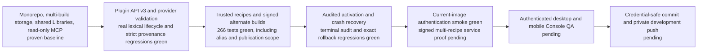

The ownership model is settled. Remaining work includes proving exact provider
delivery, hardening the implemented boundaries, proving the real service
composition, inspecting the Console, and checkpointing only after the full gate
is green.

## One-screen product map

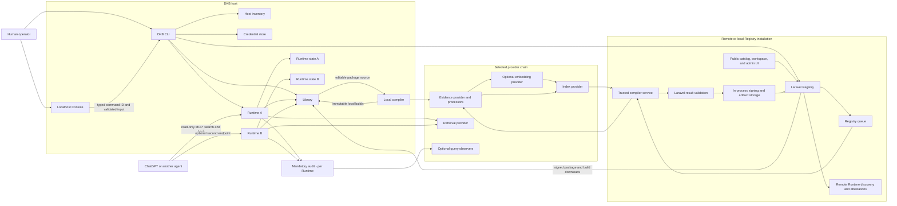

The Console does not implement a second management API. It invokes an
allowlisted CLI operation using structured input and consumes the CLI's JSON
event stream. The CLI, Runtime, compiler, and Registry client therefore share
the same domain operations whether a person uses the terminal or the Console.
The provider group represents reusable implementations in separate trusted
contexts, not one shared server spanning the Registry and every Runtime.

Public interfaces are separated by authority:

| Surface | Purpose | Authority |
| --- | --- | --- |
| Console loopback server | Host management through typed CLI operations | Local Console session/control token |
| Registry catalog API/UI | Browse public and authorized package metadata | Anonymous public access or saved host Registry credential |
| Registry publish/build API | Publish source and request trusted recipes | Scoped team token plus namespace policy |
| Runtime read HTTP | `/api/search`, `/api/retrieve`, `/api/read-targets`, `/api/read` | Read or admin credential by default; anonymous reads require explicit public-read mode |
| Runtime MCP | Remote-agent `search` and `fetch` | MCP bearer credential plus host/origin checks |
| Runtime administration | Binding, Pipeline, refresh, and install orchestration | Separate Runtime-admin credential |
| Exact layer download | One source/Evidence/Retrieval transfer | Short-lived, non-browsing install grant |

## The object model

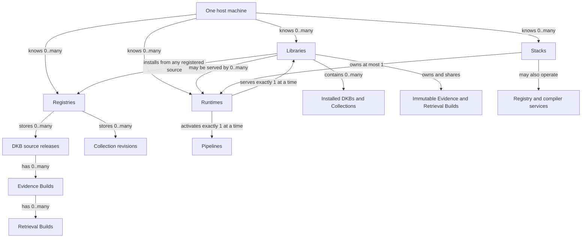

The important cardinality is:

- A **Library** can hold many DKBs and Collections.
- A **Library** can install different releases from different Registries. Its
  default Registry is only a convenience.
- A **Runtime** serves one Library and one Pipeline at a time.
- Many Runtimes can serve the same Library through different Pipelines without
  copying source or immutable builds.
- A **Registry** stores many immutable source versions and multiple trusted
  build variants beneath each source version.
- A **Collection** pins exact DKB source releases. It does not get its own
  Evidence or Retrieval Builds; each member resolves its own compatible chain.

Collection installation tracks why each member is present:

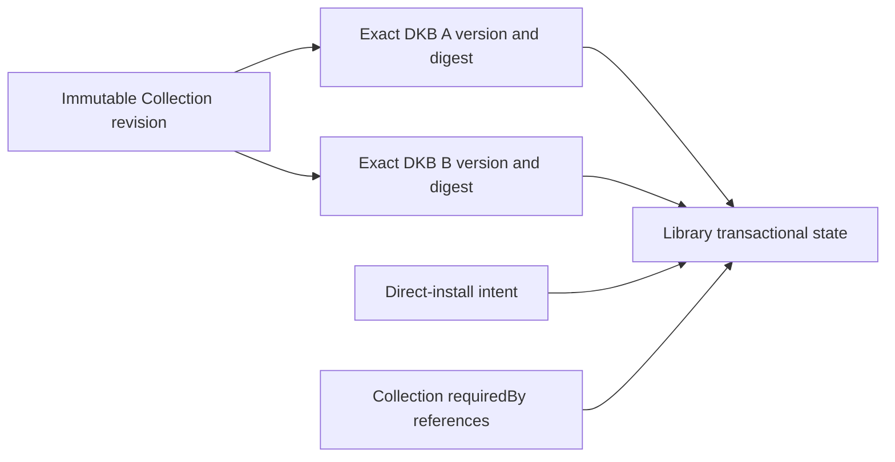

Installing two Collections that share an exact member reuses one package.
Removing a Collection removes only its `requiredBy` reference. A member remains
when another Collection or direct-install intent still requires it; otherwise
its source and Library-local builds are removed transactionally.

## Code ownership map

These arrows are package dependencies, not network calls:

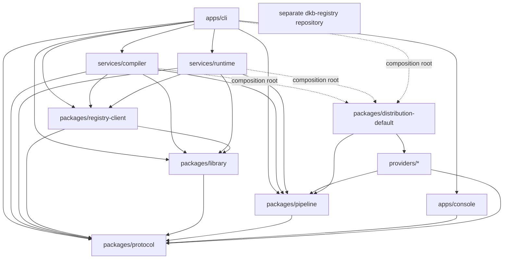

The corresponding operational calls run in the opposite direction where
appropriate:

```mermaid
flowchart LR
    Browser[Console browser]
    ConsoleServer[Console server]
    CLIProcess[Exact bundled CLI process]
    RegistryClientCall[Registry client]
    Laravel[Laravel Registry]
    CompilerService[Trusted compiler service]

    Browser -->|typed operation| ConsoleServer
    ConsoleServer -->|allowlisted spawn| CLIProcess
    CLIProcess --> RegistryClientCall -->|signed HTTP API| Laravel
    Laravel -->|trusted compile job| CompilerService
```

Dependency rules:

- Protocol is the innermost durable contract and has no DKB service dependency.
- Library depends on Protocol, never on providers or the compiler.
- Pipeline defines plugin/provider contracts but contains no concrete provider.
- Providers do not import each other.
- The default distribution is the only package that knows all bundled
  providers and named recipes.
- Compiler and Runtime domain modules receive provider hosts through their
  composition roots; they do not hard-code Docling, TEI, FastEmbed, FAISS, or
  Meilisearch.
- Laravel owns remote users, teams, namespaces, jobs, signing, and publication.
  It does not parse, chunk, embed, index, or serve queries.

### Where to start reading the code

| Question | Owning entry point |
| --- | --- |
| How does the Console run an operation? | [Typed command catalog](../../apps/console/src/server/commandCatalog.ts) and [CLI runner](../../apps/console/src/server/commandRunner.ts) |
| Where are default Pipelines and their required services defined? | [Default distribution](../../packages/distribution-default/src/index.ts) |
| How are plugins discovered and validated? | [Provider host](../../packages/pipeline/src/host.ts), [public SDK](../../packages/pipeline/src/sdk.ts), and [output validators](../../packages/pipeline/src/validation.ts) |
| How is shipped provider code checked? | [Generated integrity receipt and verifier](../../packages/pipeline/src/bundledIntegrity.ts), [verified module loader](../../packages/pipeline/src/bundledPlugin.ts), and [distribution generator](../../scripts/generate-provider-integrity.mjs) |
| How are installable tools packaged? | [Exact-dependency staging](../../scripts/package-distribution.mjs), [candidate preflight](../../scripts/release-package-candidates.mjs), and [private delivery rules](../private-releases.md) |
| What defines durable build identities? | [Protocol build contracts](../../packages/protocol/src/builds.ts) and [resolved profile construction](../../packages/pipeline/src/buildProfiles.ts) |
| Where does compilation run? | [Compiler runner](../../services/compiler/src/pipelineRunner.ts) and [trusted Registry targets](../../services/compiler/src/registryTargets.ts) |
| Where are immutable builds checked and stored? | [Library builds](../../packages/library/src/builds.ts) |
| Who changes an active Runtime? | [Runtime activation owner](../../services/runtime/src/runtime/activation.ts) and [Pipeline switching](../../services/runtime/src/runtime/pipelineSwitch.ts) |
| Who recovers an interrupted Stack start? | [Stack startup journal](../../apps/cli/src/stack/startup.ts); it restores Stack configuration/topology through the existing Runtime gate, never by writing Runtime activation files |
| Who checks Library drift before serving? | [Runtime Library-state validation](../../services/runtime/src/runtime/libraryState.ts) |
| Where is the query-to-evidence audit chain written? | [Audited query operation](../../services/runtime/src/runtime/queryOperation.ts) and [audit persistence](../../services/runtime/src/runtime/queryAudit.ts) |
| How is retained historical Evidence inspected? | [Exact Library Evidence inspection](../../packages/library/src/packageEvidence.ts); this is inert content inspection, not retrieval or signature certification |
| Where is the agent-facing surface? | [Read-only MCP](../../services/runtime/src/mcp/readOnly.ts) |

In the separate `dkb-registry` checkout, begin with `ARCHITECTURE.md`, then
`app/Actions/Registry/`, `app/Services/Registry/Compiler/`, and
`app/Policies/PackageVersionPolicy.php`. The Registry owns authorization and
publication; these files are not a second implementation of the compiler.

### Operational deployment topology

The developer Stack is target-aware. It starts only the provider services
required by the compiler and Runtime targets selected for that Stack.

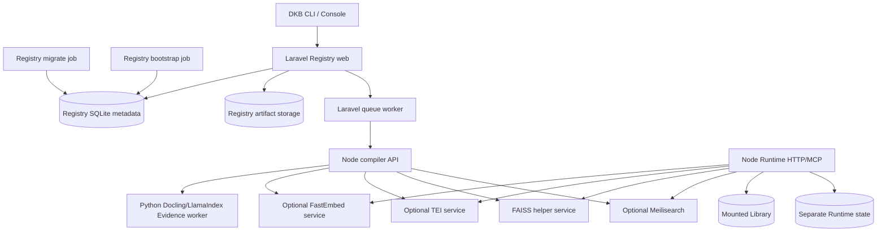

The Laravel image is built from the separate `dkb-registry` repository. The
Compose distribution consumes that image; it does not import Registry source
through a sibling checkout or mount the Docker socket into the compiler.

Stack startup owns a separate recovery journal for its environment, compiler
configuration, Runtime configuration, and previous running topology. A requested
target does not rewrite an existing Runtime's default before activation. On
failure, Stack restores its prior configuration and Library mount only while
the Runtime selection remains unchanged. If an admin response is lost, it
checks the actual committed activation before choosing recovery. It never
restores binding or activation files by copying them. Concurrent operator
changes are preserved, and incomplete restoration retains a protected journal
with an explicit `dkb stack up <name>` recovery instruction.

## Knowledge and build identity

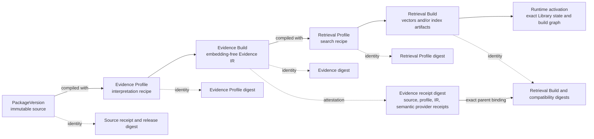

Plain-language definitions:

| Object | Question it answers | Contains |
| --- | --- | --- |
| `PackageVersion` | What knowledge is this? | Immutable source, manifest, source hashes, release provenance |
| Evidence Profile | How should the source be interpreted? | Evidence provider/parser/chunker, ordered processors, options, exact provider identities |
| `EvidenceBuild` | What records did that interpretation produce? | Embedding-free records, source anchors, locators, provenance, catalog, and semantic execution receipt |
| Retrieval Profile | How should that Evidence be searched? | Optional embedder, index, retrieval/fusion providers, options and compatibility fields |
| `RetrievalBuild` | What exact searchable artifacts were produced? | Vectors when needed, packaged or managed-index metadata, Evidence-ID mappings, receipts |
| Runtime activation | What can this endpoint serve right now? | Library generation, active Pipeline, compatibility space, exact build chain per package |

A digest is a fingerprint, not another running component. Recipe fingerprints
identify resolved instructions; build fingerprints identify the output bytes;
compatibility fingerprints say which search space may be opened together.
A signature is different: it binds a receipt to a trusted Registry key. It
does not establish that source text is true, safe, or free of hostile prose.

`EvidenceDigest` fingerprints canonical Evidence IR. The separate
`evidenceReceiptDigest` binds that IR to its source, resolved profile, counts,
and semantic provider receipts. A Retrieval Build binds both the exact Evidence
and its receipt, plus its own semantic provider receipts and artifact manifest.
Timings and cache diagnostics are recorded separately so nondeterministic
measurements do not change knowledge identity.

Profiles are recipes. Builds are stored results. Names are for people; digests
are used for Runtime resolution. A Runtime never activates "latest" or
"closest compatible" artifacts. When no target is requested, the Registry
resolves the exact Evidence/Retrieval chain recorded as that source version's
default build. An explicit target must resolve to one unambiguous compatible
build or fail.

Two target names for the same resolved recipe have the same provider-build and
profile identities. Names remain visible labels but do not alter semantic
identity. A signed build keeps its original label; accepting it under another
name still requires the full exact recipe and compatibility digests. The host
identity regression and Registry alias lookup/deduplication pass, including
actual Node-client consumption of unchanged signed target labels.

## Pipeline and plugin map

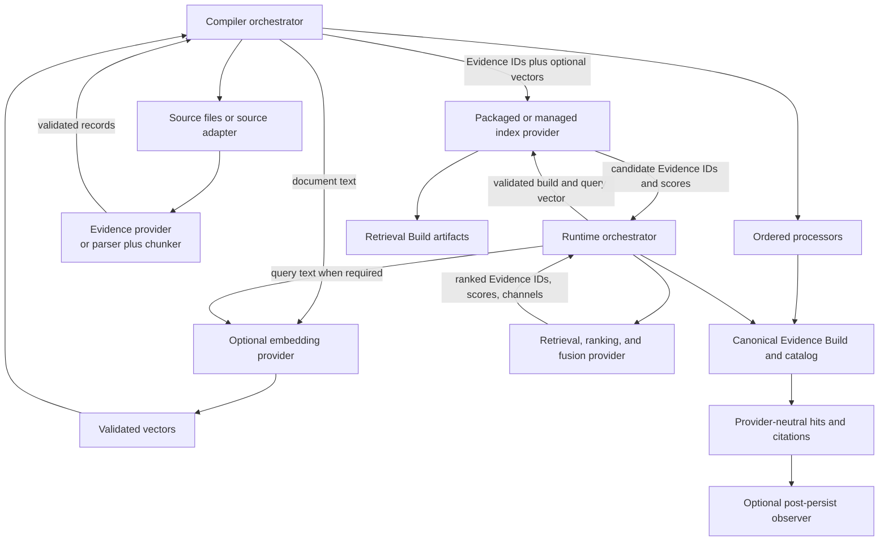

The arrows above show orchestration and contract data, not provider-to-provider
imports or calls. Compiler and Runtime invoke each selected provider; providers
remain independent implementations behind Pipeline contracts.

The bundled Evidence provider consumes package-owned source snapshots, not
manifest-supplied database connections. File and SQLite source hashes describe
the original bytes, while text hashes describe individual records. Source asset
anchors remain stable across rich/plain parsing; page, table, and row locators
describe the particular interpretation. Obsolete worker output or cached records
without the original source hash cannot supply provenance. A trusted custom
provider may implement other source adapters, but uploaded knowledge cannot
choose credentials or live external data through the retired manifest option.

Embedding is optional in the Pipeline contract, compiler, and Runtime catalog.
A lexical-only Pipeline may go directly from Evidence to a compatible
index/retrieval chain. Vector Pipelines use an embedding provider for both
document and query transforms. The focused Runtime catalog proof is green;
lexical-only service composition remains part of the final integrated gate.

Plugin discovery is context-sensitive and fail-closed:

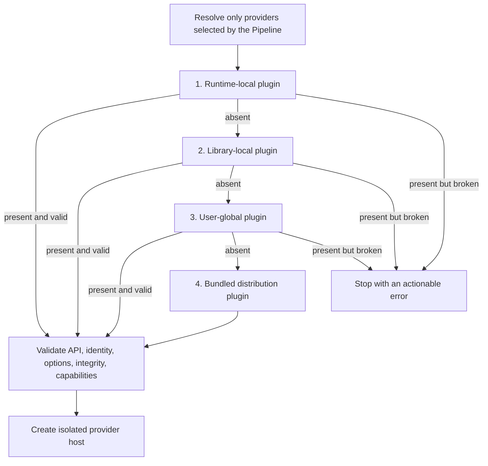

Runtime resolution uses all four levels shown above. Library-root compilation
starts at the Library-local level. A direct DKB compile uses that DKB root as
its local context unless its caller explicitly supplies the enclosing Library
context; it does not silently infer a parent Library. Registry compilation
starts at its trusted compiler context, followed by the operator's global and
bundled providers. Plugins are trusted operator code. Knowledge packages never
carry plugins, configuration, dependencies, or credentials.

The active API-v3 hardening makes `@sjshovan/dkb-pipeline` the author SDK. It
adds typed definition helpers, Standard Schema option validation, strict
provider inputs and outputs, DKB-owned canonical Evidence identities,
generated bundled integrity baselines, resolved execution receipts, conformance fixtures, and
non-mutating query observers.

Bundled provider builds generate `dist/provider.integrity.json`, binding the
plugin identity, explicit shipped-file inventory, and exact declared runtime
dependency closure. Packaging verifies that existing receipt rather than
regenerating it. The distribution holds inert module references, not imported
executable providers. After resolving higher-precedence overrides, the host
checks installed files, dependencies, and literal imports against that receipt
before importing the selected provider. It then combines the verified integrity
identity with validated semantic options and declared external identities when
resolving Evidence and Retrieval Profile digests. Static receipts contain no secrets, live
endpoints, runtime options, or model weights. Filesystem-only local plugins
retain host-computed integrity and do not require a new plugin manifest.

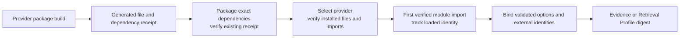

The loader binds its first import to the verified receipt, shares only that
verified module identity, and keeps provider setup, options, and state isolated
per host. It rejects a changed package/dependency identity after loading and
requires a process restart. A literal helper import missing from the receipt
also fails before module execution. Real ESM tests cover pre-selection rebuilds,
unselected throwing providers, broken overrides, concurrent hosts, and helper
drift. These checks do not sandbox arbitrary trusted operator code or certify
computed imports outside the declared contract.

Literal-import inspection uses a pinned Acorn parser, not text matching.
Strings, comments, and regular-expression contents cannot invent dependencies.
Supported TypeScript helpers are stripped with Node's native API before syntax
inspection; execution still requires the host's appropriate Node loader/flag.
Unsupported syntax fails closed. This inspection never executes provider code.

A fresh-install proof exposed ordinary npm dependency drift: `zod` and
`fast-uri` resolved to newer versions than the provider's receipt. The existing
integrity check correctly rejected the installation. Native dependency bundling
is the chosen delivery mechanism for the six deployable provider packages; the
generic SDK remains an ordinary library. Release staging verifies the existing
receipt after dependency installation and never repairs a mismatch by generating
a new receipt. All six providers now pass an offline installation and dependency
tampering test with competing host dependency versions. Inspection uses the
trusted host SDK, not an unverified verifier supplied by a candidate. The
Windows CLI distribution proof now passes with all 15 candidates and all six
installed providers verified. Linux and service-backed proofs remain below.

The bundled catalog currently declares these recipes. This is an availability
of definitions table, not a claim that all services are running or that the
latest lifecycle gate has passed:

| Target | Evidence | Embedding | Index | Retrieval |
| --- | --- | --- | --- | --- |
| `default` / `tei-faiss` | Docling/LlamaIndex | TEI, 384 dimensions | FAISS | Hybrid |
| `tei-faiss-768` | Docling/LlamaIndex | TEI, 768 dimensions | FAISS | Hybrid |
| `fastembed-faiss` | Docling/LlamaIndex | FastEmbed, 384 dimensions | FAISS | Hybrid |
| `fastembed-faiss-768` | Docling/LlamaIndex | FastEmbed, 768 dimensions | FAISS | Hybrid |
| `tei-meilisearch` | Docling/LlamaIndex | TEI, 384 dimensions | Meilisearch | Hybrid |

Named targets live in the distribution or trusted operator configuration, not
in generic Runtime/compiler conditionals. Lexical-only is a supported contract
and fixture path, not a bundled target advertised in this table.

Bundled and local providers use the same API-v3 identity declaration for
canonical external service, image, and model digests. The host validates and
sorts those declarations, merges plugin-wide and provider-scoped identities,
and binds them into the exact provider integrity digest used by Evidence and
Retrieval profiles. Operational endpoints, timeouts, batching, and secret
references remain separate from output-affecting profile options.

## Lifecycle maps

### Publish a Registry release

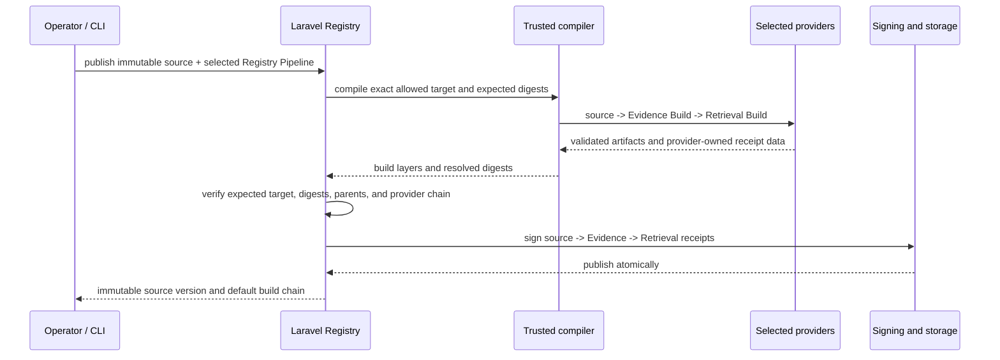

Uploaded source cannot choose plugin code or arbitrary compiler configuration.
The Registry operator advertises allowed recipes. Publication uses the Registry
default unless an authorized publisher selects another advertised recipe.
Implementation source code may be knowledge content; compilation must treat it
as inert input, not execute it as an uploaded plugin or build script.

CLI publication uses a source-only archive writer: compiled local builds,
receipts, `.dkb`, plugins, dependencies, and credentials are excluded before
upload. Normal install archives still contain their verified immutable build
chain. A compiled editable-source regression proves these are distinct archive
purposes and that publication does not mutate the original source.

### Add another build to the same source

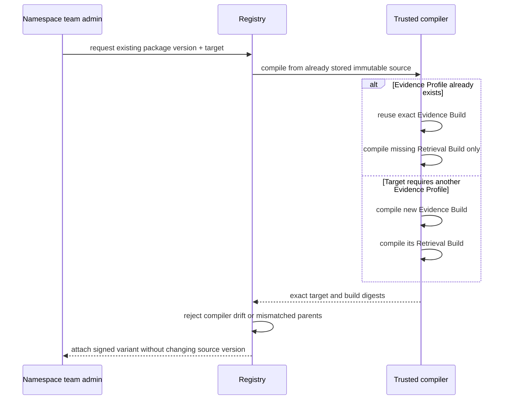

Registry-origin builds are compiled by the Registry's trusted compiler, then
validated and signed by Laravel Registry. A host never uploads a locally produced build into an
existing Registry release. Editable local DKBs may compile locally and are
visibly marked local.

### Install and activate

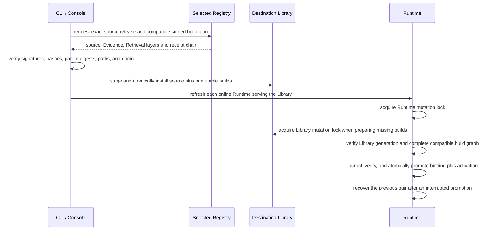

An install names its Registry explicitly. Each installed package retains its
origin and signed digests. The same package identity from another Registry is
accepted only when its immutable signed release digest agrees; a conflicting
origin fails instead of silently winning through Registry priority.

### Query through HTTP, MCP, or CLI

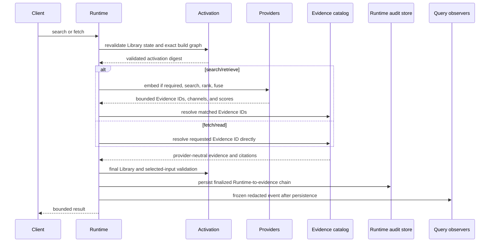

Retrieved evidence is untrusted data, never instructions. Remote MCP remains
exactly `search` and `fetch`. Observers may export telemetry but cannot mutate
the validated evidence, scores, citations, or response.
The current operation awaits observer notification after audit persistence
and before returning, with a one-second delivery budget and an abort signal.
An unfinished asynchronous delivery is not invoked again until it settles;
timeout or cancellation updates observer health without replacing the validated
response. This is not a separate durable background delivery queue. Trusted
in-process code that blocks the event loop cannot be forcibly interrupted.
The final validated snapshot and persisted event are the point-in-time response
boundary. Each request gets one terminal event; observers cannot replace that
outcome or mutate the detached response. A subsequent request rejects later
Library or provider drift. Initial build hashes and receipt
validation remain authoritative; warm reuse checks selected file identity,
metadata, directory membership, and configuration rather than rehashing every
model or index on each query. Host filesystem integrity remains a trust assumption.

Relevance belongs to the selected retrieval provider. MCP no longer suppresses
valid custom-provider results merely because optional keyword diagnostics are
absent. The bundled hybrid provider retains its conservative token-coverage
policy at the provider boundary, consistently across CLI, HTTP, and MCP. Real
MiniSearch queries now prove identical Evidence IDs, package/build chains,
candidates, and citations across those three paths. MCP reports no invented
calibrated confidence for arbitrary provider scores.

The local transport regression uses an actual CLI child process, HTTP requests,
and authenticated MCP calls against a compiled lexical package. Each channel
produces search, fetch, evidence-insufficient, and stale-Library terminal events.
Admitted events match the real activation, exact stored builds, canonical IR,
source hashes, chunk spans, scores, and citation references. Public source
locators are deliberately redacted references; audit verification must not
mistake that privacy boundary for missing provenance. This is a local editable
package proof, not the signed Registry/container lifecycle proof.

### Remote Runtime access

`dkb remote` is a discovery and Registry-attestation catalog. It does not open
sessions, proxy retrieval, install knowledge, or create a second query path.
A hosted endpoint that should be queried is registered in the host Runtime
inventory and addressed through the ordinary `query`, `read-targets`, or `read`
commands, or directly through read-only MCP. The destination Runtime therefore
owns activation verification and the authoritative audit event.

```mermaid
flowchart LR
    Registry[Registry attestation]
    RemoteCatalog[dkb remote catalog]
    HostInventory[Host Runtime inventory]
    Client[CLI or agent]
    Destination[Destination Runtime]
    Activation[Validated activation]
    Audit[Destination audit store]

    Registry --> RemoteCatalog
    RemoteCatalog -. endpoint metadata .-> HostInventory
    Client -->|direct HTTP or MCP| Destination
    HostInventory -->|select endpoint| Client
    Destination --> Activation --> Audit
```

The former `/api/remote/*` Runtime gateway, temporary sessions, proxy retrieval
methods, one-time remote install offers, and retired MCP tool naming have been
removed. Package-boundary checks reject their reintroduction.

## State and storage map

```text
~/.dkb/
├── host.json                         host convenience inventory and defaults
├── config.json                       user-global Pipeline/plugin configuration
├── plugins/                          trusted user-global plugins
├── credentials.json                  saved host Registry credentials
├── console/
│   ├── process.json                  local process/control state (private)
│   ├── activity.sqlite               redacted Console operation history
│   └── autostart*                    optional host scheduler state
└── stacks/<name>/
    ├── stack.env                     ignored local service secrets and ports
    ├── registry/                     Registry DB and artifact storage
    ├── compiler-context/              trusted Registry compiler config/plugins
    ├── compiler-jobs/                 shared compiler job transfer state
    ├── runtime/                       Runtime-owned state root
    └── provider caches/               disposable model/service caches

<library>/
├── dkb.json                          Library manifest
├── dkb-lock.json                     exact logical DKB/Collection resolution
├── <editable-dkb>/                   author-controlled source
│   └── .dkb/builds/                  package-local immutable derived builds
│       ├── evidence/<profile>/<digest>/
│       └── retrieval/<profile>/<digest>/
├── vendor/@namespace/name/           Registry-installed immutable source
│   └── .dkb/builds/                  package-local installed build layers
│       ├── evidence/<profile>/<digest>/
│       └── retrieval/<profile>/<digest>/
└── .dkb/
    ├── state.sqlite                  authoritative applied package state
    └── plugins/                      trusted Library-local plugins

<runtime-state>/
└── .dkb/
    ├── runtime-binding.json          selected Library
    ├── runtime-activation.lock.json  active Pipeline and exact build graph
    ├── runtime-selection.transaction.json
    │                                  crash-recovery journal, present only during promotion
    ├── locks/runtime-mutation.lease.sqlite  native cross-process mutation ownership
    ├── managed-index-retention/      backing-store-bound import and cleanup receipts
    ├── query-audit.sqlite            query and evidence audit chain
    ├── trace.sqlite                  ordered retrieval diagnostics
    └── cache/                         disposable Runtime cache root
```

Libraries logically own installed package builds, while the immutable bytes are
stored beneath each package root rather than in one shared Library build
directory. Libraries do not own an active Pipeline. Runtimes do not own source
or build bytes. The Runtime activation lock contains identities and digests,
not machine-specific build paths. Runtime-admin secrets live in ignored
Stack-local environment state, not in the Registry credential document.

The Registry stores the same logical chain in separately signed layers and also
materializes one derived combined archive for the default download route:

```text
PackageVersion
├── immutable source archive and signed source receipt
├── signed source.inventory.v1        bounded remote source-tree metadata
├── EvidenceBuild[]                   .dkbevidence layers
│   └── RetrievalBuild[]              .dkbbuild layers
└── default combined download         derived .dkbpkg convenience archive
```

## Trust and authority map

| Boundary | Authority and rule |
| --- | --- |
| Source author | Owns source and manifest, but source content is untrusted during compilation and retrieval |
| Local operator | May install trusted filesystem plugins and locally compile editable DKBs |
| Registry operator | Chooses trusted compiler context, allowed recipes, default recipe, services, and signing keys |
| Namespace team admin | May publish source and request additional Registry builds for its namespace |
| Other Registry users | Cannot attach builds to someone else's source; they must fork under their own namespace |
| Compiler | Produces candidate artifacts but cannot self-assert another plugin identity; DKB constructs receipts from loaded code |
| Registry | Verifies compiler result against the queued recipe, then signs immutable source/Evidence/Retrieval chains |
| Library | Verifies packages, receipts, paths, and transactions; filesystem presence alone never means installed |
| Runtime | Serves only an exact valid activation and fails closed on Library, provider, or artifact drift |
| MCP client | Can search and fetch only; it cannot install, compile, publish, mutate, or load plugins |
| Open-source owner | Can modify their own software; DKB guarantees apply only to artifacts passing the declared validation and receipt path |

Registry requests cross two separate rate-limit boundaries. The first protects
credential lookup itself; the second applies the authenticated principal or
install-grant policy for the requested operation:

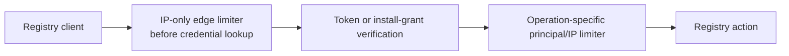

Forwarded client addresses are trusted only from an explicit operator-supplied
proxy allowlist. The default trusts no proxy, and the developer Compose binding
publishes the Registry only on localhost.

## Current implementation status

### Established product shape

- Independently packaged CLI, Console, compiler, Runtime, Protocol, Library,
  Pipeline SDK, Registry client, distribution, and concrete providers.
- PackageVersion -> Evidence Build -> Retrieval Build storage, with immutable
  package-local builds reused by independent Runtime activations.
- Many Runtimes may serve one Library through different Pipelines. A Library
  may install knowledge from multiple Registries.
- The Console invokes typed CLI operations; agents use read-only Runtime MCP.
- The separate Laravel Registry owns authorization, jobs, validation, signing,
  catalog metadata, and release storage.

### Active hardening, not a completed release

| Boundary | Working-tree implementation |
| --- | --- |
| Plugin authoring | API v3 SDK, Standard Schema options, scaffolds for nine provider kinds, and one public conformance suite used by local and bundled providers |
| Provider validation | Explicit protected provenance; detached processor inputs/outputs; dense vector and candidate arrays; DKB-owned canonical Evidence identities; scope, score, lifecycle, and receipt validation |
| Reproducibility | Generated bundled file/dependency receipts; verified selected-only module loading and literal-import inventory; pinned model/service identities; semantic receipts separated from timing/cache diagnostics; exact-dependency release delivery is under proof |
| Registry recipes | Trusted catalog, explicit/default publication target, authorized alternate builds, exact Evidence reuse, queue deduplication, and compiler-drift rejection |
| Signed acquisition | Exact source -> Evidence -> Retrieval chain; Registry transport addresses are separate from retained package origins; local builds cannot replace signed Registry builds |
| Activation | Runtime-owned binding and activation, shared mutation/recovery gate, crash journal, exact graph validation, isolated Runtime caches |
| Query safety | Cold catalog comparison against canonical Evidence IR; warm code/configuration/file drift checks; queued selection reads; final validation before releasing a response |
| Audit | Shared CLI/HTTP/MCP operation, exact Runtime-to-evidence chain, actual scores/channels, frozen post-persist observer events, bounded non-overlapping asynchronous delivery, and per-observer health |
| Console | Typed source-only publication with searchable Registry Pipelines; exact build trust checks; nullable historical audit chains; links to retained exact builds and bounded inert Evidence. Focused tests and production build pass; browser acceptance remains |

Library-root compilation orchestrates editable DKB builds and retains
Registry-origin packages; Collections remain dependency intent and are not
compiled. Fused Evidence providers currently accept record processors;
document/chunk processors require the separate parser/chunker path.

The dormant write queue and remote-query proxy/session surface have been
removed. Remote discovery records endpoints and attestations; actual queries
go directly to the destination Runtime's normal activation and audit gate.
Public package-boundary checks prevent alternate raw query entry points.

### Prior verification snapshot (HTTP-security checkpoint)

This historical table distinguishes local regression coverage from complete
service proof. The dated checkpoint sections at the top supersede its running
totals; these results do not certify later Library recovery edits.

| Gate | Latest result |
| --- | --- |
| Workspace TypeScript | Exact `npm run check` passes for all 15 workspaces and Console Vue after the current import-checker and conformance corrections |
| Console production build | Current clean workspace build passes, including publication, build verification, and historical audit/Evidence components |
| Node integration suite | September 13 complete run: 518 passed, zero failures, cancellations, or skips; 397.348 seconds. Includes Runtime/compiler HTTP authority, endpoint-scoped credentials, real CLI/Console credential resolution, and the existing provenance, activation, audit, and SDK regressions |
| Laravel Registry | September 13 full suite: 304 tests / 23,517 assertions passed in 130.122 seconds, including compiler authentication, terminal credential failures, and preserved transient retries/cancellation. Full Pint and PHPStan pass with process-only 1 GiB PHPStan memory. The tested index-only migration still requires live lifecycle proof |
| Latest bounded corrections | Runtime audit/switching set 41/41 plus two isolated catalog tests; provider/capabilities set 64/64; lexical/SDK/provenance/recipe-saving set 64/64. These suites overlap and must not be summed; they are not Docker proof |
| Current transport and Console integration | 28/28 tests pass after the full build: real lexical local/HTTP compilation; CLI/HTTP/MCP query/audit equivalence; MCP authentication and read-only tools; hybrid relevance; Console publication and audit presentation. Exact historical Evidence inspection separately passes six tests |
| Latest real-transport audit | One additional integrated proof passes within the full suite: 12 terminal events from actual CLI, HTTP, and authenticated MCP calls, covering exact local package/build/evidence chains, insufficiency, and rejection after Library removal. Registry signatures and bundled services are not emulated by this proof |
| Source provenance and startup recovery | Five focused Python/public-provider source-policy tests pass, and nine Stack startup/recovery cases pass; all are included in the full suite. Stack cases use real compile/activation/query paths with the Compose subprocess boundary simulated, not a running container |
| Cross-language receipt signatures | Saved Evidence/Retrieval signatures verify with the actual Node Protocol; differential serialization covers 21,906 finite numbers and four nested/Unicode documents |
| Provider identity and model fixtures | Focused 40-test set passes; includes renamed targets, fail-closed overrides, shipped files, and dependency integrity |
| Generated bundled receipts and loading | Nine real ESM loader regressions pass within the complete suite; all six providers pass native offline bundle installation and dependency tampering; trusted-verifier plus private-release set passes 16 tests |
| Selected CPU Evidence model assets | Nine real downloads, 416,666,485 bytes, pass SHA-256 verification; no model weights enter source or knowledge packages |
| Package, documentation, architecture checks | All 15 package inspections passed: 9,485 entries. Dependency graph, boundaries, 18 guidance files, 33 documentation files, and six provider integrity receipts pass. Refreshed Graphify navigation contains 490 nodes / 1,025 edges / 19 communities; it is navigation, not performance evidence |
| Windows/Linux CLI distribution | September 13 exact-archive proof passes on both platforms: 15 archives installed into isolated global prefixes; CLI 0.2.0 runs help/version and initializes unrelated directories; all six provider receipts verify. User global launchers unchanged. Test installs and Linux container removed; deletion of the outer temporary cache copy was blocked, so the Temp cleanup gate remains open |
| Console corrections | Seventeen focused UI tests plus Vue types pass: historical package links are withheld during failed/pending checks, full build digests and numeric sizes remain sortable/filterable, and build requests require a fresh healthy selection. The real isolated fixture produced ten audit events and cleaned up completely. Browser URL policy blocked navigation; no visual approval is implied |
| Live host | Docker 28.3.2 is available. Four distinct local candidate image tags passed disposable startup/activation and all 26 authentication assertions. Own Stack containers/volumes and proof root removed; existing user resources unchanged. Compiler publication, cancellation, and signed lifecycle were not exercised by this smoke |
| Final performance / image / live Console proof | Not yet passed for the current changes |

The repaired Node fixtures now satisfy the strict provider contract and use
local synthetic providers where the test does not require Docker. Production
identity and receipt validation were not weakened.

The new distribution checks exposed and fixed extra prepack output that broke
machine-readable package reports. The integrated rerun also exposed a real
early-timer-wakeup polling defect: Registry retries now wait until their exact
scheduled timestamp and stop at the original operation deadline. A deterministic
regression fails on the old behavior and passes on the correction.

The current warm provider-input guard measured 40.34 ms median over 40 valid
assertions after five warmups, covering 1,608 paths. Configuration was absent
in that isolated context, and package-install activity may have overlapped the
measurement. Continuous bounded workers replace fixed-batch barriers while
preserving every check and the same 32-operation concurrency limit. This is
a loaded-host component measurement, not idle-host speedup evidence or proof
of the end-to-end no-more-than-10% regression gate.

### What the earlier live proof established

An earlier FastEmbed Docker lifecycle in this milestone passed signed source
publication, install, three known-answer queries, hostile-source isolation,
unrelated-query insufficiency, authenticated read-only MCP, public citation
links, uninstall/disappearance, reinstall without compilation, and update.

The subsequent TEI switch rejected differing host/container profile identities
and preserved the previous FastEmbed activation. Focused portability, model,
dependency, receipt, and scope repairs followed. Those repairs need new images
and the same real lifecycle before they can be called proven.

The earlier Windows global-tarball proof passed help, version, and initialization.
The strengthened run adds verification of the installed provider closure and
correctly rejected fresh npm dependency drift for `@dkb/embedding-fastembed`.
The corrected native-bundle path now passes the all-six offline and tamper test
and the complete Windows CLI distribution proof, including installed-provider
verification through the trusted host SDK. The September 13 Windows/Linux
distribution rerun now certifies the current archives. Earlier service-backed
provider-conformance proofs remain historical evidence, not certification of
the current images or signed build lifecycle.

### Remaining implementation and proof before this milestone is complete

The source audit distinguishes these remaining implementation requirements
from the operating proofs below. A passing earlier fixture does not close a
newly demonstrated bypass.

| Boundary | Required correction / evidence |
| --- | --- |
| Registry storage | New paths include namespace, package, version, and unique write identity; storage failures are fatal and rollback is isolated. The 266-test Registry gate verifies this correction |
| Ready-build API | Both PHP ready branches now include the target consumed by the actual Node client; cross-language regressions pass |
| Offline signed activation | Implemented and focused regressions pass: pin origin-fetched keys only after verification; validate exact signed chains at cold admission; reject missing trust or receipts. Offline verification uses last-known key revocation state, not a fresh Registry check |
| Activation promotion | Implemented and focused regressions pass: revalidate the original host and entire prepared graph immediately before promotion, preserving prior activation on drift. Managed rollback discards only a validated newly created exact index; changed ownership or failed cleanup yields an actionable orphan warning, never broad uninstall |
| Retained variants | Verified local variants avoid networking; already-published variants use read/download authority; only absent variants request compilation. Runtime retained, HTTP download alias, and CLI grant regressions pass without rewriting signed target labels |
| Cache and plugin admission | Cache keys include complete embedding integrity and semantic options; reject credentials introduced by schema defaults; dispose failed registrations exactly once; verify definitions without setup; scaffold the actual SDK version. All corrections pass the combined suite |
| Physical execution | Bind managed provider execution to immutable image IDs and pinned model identity. External HTTP image identity remains operator-attested, not proven by `/info`. Actual Compose/image and performance proofs remain required |
| Runtime audit | Focused proofs cover rejected-before-admission records with honest nullable fields, one terminal outcome, mandatory successful persistence, and cross-process IDs. The final validated snapshot and persisted response form the response boundary; observers run afterward and cannot rewrite it. Later drift fails the next request |
| Console completeness | Typed source publication, Registry Pipeline selector, exact historical build/Evidence drill-through, and per-build signature checks pass focused tests; inspect real rendered desktop/mobile flows |
| Pipeline catalog | Resolved-origin requirements, trust-aware coverage, strict versioned client transport, full integrity receipts, and boot-bound compiler identity pass focused tests. Alias resolution must keep exact digest checks and immutable signed labels |
| Registry job cancellation | Superseded by the committed worker-confirmed checkpoint above: the Evidence service acknowledges exact-job termination before cleanup; lost acknowledgment and restart retain unresolved execution state. Real rich-parser cancellation and PID-1 restart proofs pass. This does not certify the separate full signed multi-recipe lifecycle |
| Evidence identity scope | Corrected and tested: Evidence digests are scoped beneath PackageVersion, so identical empty IR can coexist without changing canonical bytes or signed artifacts. Index-only migration preserves rows/files; live deployment proof remains |
| Runnable alternate example | The checked MiniSearch example uses explicit parser/chunker provenance and no embedding provider. Public conformance, nonempty retrieval, two Runtimes, scope, corruption rollback, stale-state rejection, removal and retained-build reuse pass through real CLI configuration. It is not a Registry or performance parity proof |
| SDK conformance parity | Corrected and carried through the full Node rerun: complete compatibility/count/readiness checks, overlapping out-of-scope retrieval fixtures, host-owned health identity and strict booleans, and cleanup of only validated newly created managed test indexes after failure |
| Literal import validation | Corrected and focused-proven with pinned Acorn: preserve declared-dependency, path, and shipped-file checks without misreading strings/comments. Node-native supported TypeScript is tested; computed imports remain outside the declared reproducibility guarantee |
| Packaging cancellation | Corrected and carried through the full Node rerun: cancellation reaches native npm commands, cleanup waits for child closure, and the six-provider offline/competing-dependency/tamper proof passes. Its isolated run took 158.96 seconds. The packaging test has a separate 600-second safety budget, not a relaxed compile/query performance gate |
| Service-proof composition | Corrected and nine focused regressions pass: use the actual Stack Library mount and the existing CLI host-image attestation in proof and benchmark contexts. This is fixture-backed wiring evidence, not a claim that Docker ran |
| Source snapshot provenance | Original source hashes are mandatory worker output; rich/plain parsers retain the same asset anchors and avoid hashing once per chunk. Old native caches miss rather than fabricating provenance. Manifest-supplied external database connections and out-of-root SQLite snapshots fail before connection; package-owned snapshots and trusted custom SDK providers remain supported |
| Stack startup recovery | Nine regression cases cover pre-start failure, remount rejection, same-target restart, lost responses after committed activation, concurrent operator changes, recovery on retry, malformed journals, and abandoned-lease contention. Stack uses Runtime-owned validated readers and never restores binding/activation bytes itself. Actual Compose restart/failure proof remains |
| Multi-recipe service harness | Implemented and fixture-tested: three trusted recipes, two Evidence Builds, three Retrieval Builds, exact signed parent chains, changed rich/plain interpretation, concurrent request deduplication, and two independent Runtimes. Actual Docker execution remains pending |
| Performance evidence | Component reports explicitly withhold whole-system promotion. The audit found no retained comparable baseline with three full compilations and complete audited warm queries. A new integrated harness is being added; neither a component result nor a newly established current baseline can retroactively prove the milestone's 10% regression limit |

1. Preserve the September 13 Windows/Linux distribution and complete regression
   checkpoints; rerun them after the next implementation slice. Complete the
   remaining owned Temp cleanup. Candidate delivery still uses the same verified
   archives and fails before publication when a required workspace is private;
   no publication is authorized by this milestone.
2. Current-image HTTP authentication and acknowledged worker cancellation
   proofs pass. Complete Library crash recovery and the signing/retention gates
   listed at the top of this map. Verify exact model consumption and
   host/container profile equality before signed lifecycle proof. Local
   dependency, model, receipt, and scope repairs have passed the integrated
   regression suite; the signed service-backed build-selection proof remains
   the acceptance boundary.
3. Complete alternate-target switch, switch-back, a changed Evidence Profile,
   and concurrent multi-Runtime lifecycle using the transport/origin correction.
   The previous failed switch preserved the prior FastEmbed activation, as
   required.
4. Rerun the service-backed provider, useful-real-corpus, performance, security,
   and read-only MCP proofs against the final images.
   The service harness now includes the changed-Evidence recipe, simultaneous
   independent Runtime, and exact Registry parent-chain assertions. Execute it
   against final images; extend its signed-service audit comparisons across
   CLI/HTTP/MCP and complete explicit 768-dimensional conformance. The passing
   local lexical transport proof is not a substitute for those service checks.
   Measure full compilation and complete warm Runtime queries against a
   comparable baseline; component timings are not substitutes.
5. Carry lexical-only configuration, Runtime-owned Stack binding, and
   crash-journal recovery through service-backed failure/restart proofs.
6. Complete one batched desktop/mobile Console inspection for the new Registry
   Pipeline, build-trust, and Runtime-audit surfaces and correct any material
   responsive or interaction defects.
7. After service-proof fixes, rerun affected regression suites and the final
   release checks: Windows/Linux tarballs, image inspection, performance limits,
   security corpus, package and documentation checks, and DKB-only Temp audit.
8. Audit and push green checkpoints to both private `development` branches,
   excluding machine-local Registry MCP files and unrelated secrets/data.

The latest read-only DKB Temp audit finds twelve older retained/diagnostic
directories plus the timed-out native-install fixture. Guarded cleanup of that
new fixture was also denied and was not retried; it has no detected live owner.
The passing corrected native-install run, isolated Console review fixture, and
fresh Windows distribution proof cleaned up their own new directories.
The final full Node rerun added no retained temporary root. No cleanup denial
was retried. Final cleanup remains bounded to
verified DKB resources; unrelated Temp or Docker data is never in scope.

The local Console root returned HTTP 200 from `http://127.0.0.1:7338` during
this review. This verifies reachability, not authenticated host operations or
downstream service health. Earlier desktop/mobile inspection covered the
existing layouts; final healthy-proof-data confirmation is still pending.
The current isolated Console review could not navigate because the browser's
URL policy blocked it. No alternate browser, port, or indirect workaround was
used. Its servers and private handoff were removed through normal fixture
cleanup; the visual gate remains explicitly unproved.
Docker Desktop's Linux engine is currently unavailable. A normal start crashed
because the inference socket could not be accessed; no reset or socket deletion
was attempted. Earlier diagnostics proved internal Registry
reachability; restoring Docker and rebuilding the changed images are required
before alternate lifecycle, performance, and final image-inspection gates.
No unrelated Docker files were removed to recover the engine.

### Known production hardening after the current proof

These are tracked architectural risks rather than hidden assumptions:

- The current source receipt includes the initial compiler lock, so it is not
  yet a completely build-independent source-only attestation.
- Collection revisions pin exact package releases but are not yet Ed25519
  signed as first-class Registry releases.
- DKB-versus-Collection identity uniqueness is enforced in application logic,
  not one atomic database constraint spanning both object types.
- Only active signing keys are exposed; historical-key verification and a full
  rotation/retirement workflow remain incomplete.
- Registry-to-compiler HTTP now requires an application-level service credential;
  final fresh-image verification remains separate from focused transport tests.
- Remote Runtime verification needs production egress/SSRF policy beyond URL
  validation.
- Transaction rollback cleans staged files, but a hard crash can leave
  unreferenced objects; the Registry has no orphan reconciler yet.

### Structural corrections awaiting integrated proof

- Library-root `build`, `compile`, `serve`, `watch`, and `restore` orchestrate
  editable DKB PackageVersion builds and retain Registry packages;
  `compileCollection()` and activation-free `resolveLibraryRuntimeBuilds()` are
  removed.
- The dormant write queue and remote Runtime proxy/session surface are removed,
  with boundary checks preventing those alternate lifecycle paths from
  returning.
- Provider service identities are supplied by the host composition root as
  immutable OCI digests or local Docker image IDs; compiler and Runtime domain
  code remain Docker-blind.

These corrections have focused coverage. They are not a claim that every
bypass has been eliminated; the final integrated and Docker lifecycle gates
remain authoritative.

## Deliberately deferred

- Cross-Runtime result fusion, comparison scoring, or an agent gateway.
- Write-capable remote MCP or agent-controlled package mutation.
- A public deployment or production-scale Registry topology.
- Automatic plugin distribution through knowledge packages or a plugin
  Registry.
- Public npm/image publication or merging either repository to `main`.

## How to keep this map current

Update this file whenever an accepted change alters ownership, cardinality,
trust, a stored identity, or a lifecycle boundary. Ordinary internal refactors
do not require a diagram change.

For each update:

1. Inspect both repositories' `development` branches and working trees.
2. Verify changed claims in source and tests; do not promote an accepted ADR to
   **Proven baseline** without its acceptance evidence.
3. Update the snapshot commit IDs and date.
4. Update the object, code, lifecycle, storage, and trust maps together when a
   boundary moves.
5. Put the rationale in an ADR and link it here; do not bury decisions in this
   status document.
6. Regenerate the workspace dependency graph and run the boundary and docs
   checks.
7. Refresh Graphify after structural code changes. Use it to detect drift and
   surprising coupling, then verify every inferred relationship in source.
8. Keep unfinished work in **Active working tree** or **Pending proof** until
   the complete gate passes.

Primary verification commands:

```powershell
npm.cmd run graph:check
npm.cmd run boundaries:check
npm.cmd run agents:check
npm.cmd run docs:check
npm.cmd run check
npm.cmd test
npm.cmd run proof:providers
```

Registry verification follows its own `AGENTS.md`: focused Pest tests, the full
suite, static analysis, Pint, and the production frontend build when relevant.

## Related documents

- [Final provider architecture](final-provider-architecture.md)
- [Workspace dependency graph](workspace-dependency-graph.md)
- [Artifact architecture](../artifact-architecture.md)
- [Provider pipeline](../provider-pipeline.md)
- [Library and Collections](../library-and-collections.md)
- [Operations](../operations.md)
- [Security](../security.md)
- [ChatGPT and MCP](../chatgpt-mcp.md)
- [Architecture decisions](../decisions/)
