# DKB System Map

This is the canonical, human-facing map of the complete DKB product. It is
intended to answer two questions:

1. How do all DKB components and stored objects fit together?
2. Which parts are proven, currently being hardened, or still awaiting proof?

The map describes `project-dkb` and the separate Laravel `dkb-registry`
repository as one deployable product. Detailed provider rules remain in the
[provider architecture](final-provider-architecture.md), while accepted changes
remain recorded under [architecture decisions](../decisions/).

## Snapshot

- **Map revision:** 35
- **Checked against:** both `development` branches on 2026-09-13
- **Committed HTTP-security checkpoint:** DKB `59b2cdc`, Registry `18123c9`
- **Active milestone:** Plugin API v3, trusted Registry recipes, multi-build
  hardening, one Runtime activation gate, and complete query audit chains
- **Release state:** private developer preview; not published or merged to
  `main`
- **Checkpoint state:** HTTP authentication is committed. Worker-confirmed
  compilation cancellation is the current verification boundary. The broader
  milestone remains incomplete; historical green runs do not certify later edits.

### Safety hardening continuation

The committed boundary covers authenticated ordinary Runtime HTTP and the
Registry-to-compiler channel, using the existing service and host-credential
ownership. Runtime reads now default private; admin and read credentials remain
separate from MCP. CLI process launches generate endpoint-scoped host secrets,
and Stack preparation supplies matching internal compiler credentials to both
services. Public discovery/reads and public citation documents are independent
operator opt-ins. See [security](../security.md#runtime-and-compiler-http) and
[operations](../operations.md#runtime-http-access).

The updated production build and full Node suite pass: **518 tests, no failures
or skips**. Registry passes **304 tests / 23,517 assertions**, Pint, and PHPStan
with a process-only 1 GiB allowance. Workspace boundaries, dependency graph,
guidance, documentation, provider integrity, and all 15 package inspections pass.
All 15 exact tarballs also passed isolated global installation on Windows and
Linux, including fresh-directory initialization and all six provider integrity
checks. Existing user CLI launchers were unchanged.
Focused real-HTTP authentication tests and the existing local lexical
CLI/HTTP/MCP audit paths pass. Fresh Runtime, compiler, and Registry images built
under separate local tags. The first disposable Stack checks correctly rejected
an outdated FastEmbed image: its actual health implementation omitted the
required model repository and revision. Rebuilding that unchanged provider source
under a separate tag resolved the deployment mismatch without weakening checks.

The fresh disposable Stack then passed **26 HTTP assertions**: 13 Runtime
authority/Host/Origin checks, seven compiler checks, the authenticated Registry
catalog with matching compiler build identity, and five MCP checks. MCP accepts
only its own credential and exposes exactly read-only `search` and `fetch`.
Typed CLI access resolved saved Stack credentials. Startup/activation took 42.0
seconds; the smoke including teardown took 108.5 seconds. All owned Stack
containers, volumes, and the proof root were removed. Two owned temporary
cache/inspection directories remain because deletion was blocked by command
policy; the final Temp cleanup gate is still open. No user Stack or knowledge
was changed, and no image was published or existing tag overwritten.

This proves authentication integration, not a fresh signed compilation or
knowledge lifecycle. Worker-acknowledged cancellation is the current checkpoint.
Following work remains ordered: durable Library crash recovery; historical
signing keys and signed Collection receipts; bounded Console retention; then
the signed multi-recipe, two-Runtime lifecycle and comparable performance proof.
These are extensions of existing components, not a new architecture.

### Worker-confirmed cancellation checkpoint

The [cancellation decision](../decisions/0011-worker-confirmed-compilation-cancellation.md)
keeps one warm, supervised parser child in the existing Linux Evidence service.
Service version 5 binds requests and terminal acknowledgments to an exact job
and token hash. Cancelling the HTTP request alone never permits scratch cleanup.
The supervisor kills and reaps owned workers and descendants, then starts a new
child with new IPC. The service must run as container PID 1.

The compiler journals pending provider work before dispatch and holds a private
SQLite owner lease. After a Node crash, recovery re-resolves the exact recorded
provider, recipe, and options before asking that provider to stop its worker.
Missing acknowledgments, changed providers, and unresolved cleanup retain the
workspace and execution record. The Registry keeps that original execution in
`cancelling`; it neither publishes a partial result nor automatically retries it.
An explicit unconfirmed result without recoverable provider metadata also stays
pending rather than being treated as proof of stopped work.
Both result formats reject unsettled workers before delivery. A flushed finish
marker is required for cleanup, including after errors persisting recovery state.
Archive upload names cannot redirect writes outside the owned workspace.

Fresh Registry verification passes **308 tests / 23,570 assertions**, Pint, and
PHPStan with a process-only 1 GiB allowance. The final Node suite passes **553
tests, no failures or skips**, including the opt-in Docker worker proofs.
TypeScript/Vue checks, the production build, workspace and documentation gates,
and isolated provider-image checks pass. All fifteen exact archives pass
inspection and fresh-directory global CLI installation on Windows and Linux;
all six installed provider receipts verify, and user CLI launchers are unchanged.
Eighteen Linux worker-control tests
cover child reuse, hard termination, descendants, deadlines, caller disconnect,
and executor draining. A real Node-to-container proof passes uncached Markdown
compilation, warm-worker reuse, running cancellation, lost control responses,
retained work, and exact pending-worker recovery. A separate rich PDF proof
confirms active parser CPU work stops before acknowledgement, no subsequent
writes, and successful replacement-worker compilation. A ten-check real PID-1
crash/restart proof verifies the old process identity has ended, exact-job
`worker_restarted` acknowledgement, and no later writes. Recovery keeps its
original trusted endpoint; changing a randomized Docker host port does not
authorize forwarding the private job token to another URL.

The initial deployed-image comparison was not a valid matched baseline: the old
image also predates existing parser provenance and pinned-asset changes. Its
records lacked current source hashes and compiler metadata. Extraction text and
chunk locations matched, but its recipe and identities were not current.

A controlled comparison uses the same new immutable image, parser, models, and
dependencies on both sides, with only the previous committed service module
mounted into the baseline. All twelve normal outputs are identical. Five warm
runs per side give medians of **4.702 seconds before / 4.147 seconds after**,
within the 10% regression gate. Samples varied considerably; this is bounded
worker verification, not a general speedup claim or the missing whole-system
signed lifecycle benchmark. The single cold sample was 19.408 seconds before /
23.710 seconds after; repeated cold measurements and full-system resource gates
remain unproven. No existing Library, Stack, package, or image tag was changed.

Disposable worker containers were removed. Command policy blocked cleanup of
three owned diagnostic roots from the comparison/restart proofs; they remain
outside Git, alongside the two earlier cache/inspection leftovers. Combined
owned leftovers are approximately 5.2 GiB. No retry through another deletion
mechanism was attempted, and the final Temp cleanup gate remains open.

### Stopping point and resume order

This remains an incomplete milestone, not a completed release. The following
table preserves the previous handoff evidence; the September 13 continuation
above supersedes its stopped-session and unverified-SDK status. Preserve both
development trees and the Registry's machine-local MCP configuration.

| Work | Handoff state | Next action |
| --- | --- | --- |
| Plugin, Registry, Runtime, source-policy, and Stack hardening | Last complete build and Node run: 498 passed, two Docker skips; Registry: 266 passed / 23,327 assertions, PHPStan and Pint passed | Retain the underlying fixes; rerun affected gates after the unfinished SDK changes |
| Windows package distribution | Fifteen exact archives installed; all six installed provider receipts verified; 9,473 archive entries inspected; existing global launchers unchanged and owned scratch removed | Repeat after the final SDK/provider edits; Linux remains unrun |
| Generated SDK examples and public conformance | Source edits only: real packaged/managed lexical index examples, strict options, original-byte source hashing and stable timestamps, rejection of null/empty known-answer index and retrieval results | First type-check all generated examples and run `tests/plugin-sdk.test.mjs` and `tests/plugin-conformance-boundaries.test.mjs`; these last edits have not been emitted or proven |
| Evidence in-flight cancellation | The gap is identified; the incomplete Node-only wiring was withdrawn rather than leaving a call to an unimplemented Python endpoint | Propagate cancellation through an owned worker job; stop new work, settle existing writers before cleanup, and retain only the exact job on unconfirmed cancellation. Prove actual in-flight cancellation and cleanup with real loopback transport |
| Whole-system performance harness | Three syntax-checked, unexposed drafts: `scripts/lib/benchmark-corpus.mjs`, `scripts/lib/system-benchmark-report.mjs`, and `scripts/lib/system-benchmark-sample.mjs`. There is no executable parent harness or accepted benchmark result | Complete bounded orchestration, cancellation/disk guards, report persistence, shared generator integration, comparison tests and three-run integration; then measure real bundled services and full service memory against a genuinely comparable baseline |
| Signed multi-recipe service proof | Three-recipe/two-Runtime harness implemented and fixture-tested, not executed against the final images | Restore Docker; prove signed Evidence reuse/change, independent switching, lifecycle/rollback/restart, 384/768 dimensions, FAISS/Meilisearch and exact CLI/HTTP/MCP audit chains |
| Console and ChatGPT proof | Focused Console tests/build passed earlier; current authenticated mobile/desktop visual review and final ChatGPT proof remain unverified | Complete permitted browser QA at 320px and 1440px, then real-corpus and synthetic security/citation checks. Do not bypass the browser URL-policy denial |
| Final delivery | Documentation map updated; final graph refresh, package/image inspection and green private checkpoints still pending | Run the full final gate and credential-safe audit, then commit/push only to the private `development` branches; no public release or `main` merge |

The September 13 production build and distribution proof supersede the historical
build-only stopping point. Do not replace the missing performance baseline
with component timings or claim that syntax-checked drafts complete the gate.

### Read this first

The core product architecture exists. The current milestone still includes
implementation as well as proof. Bundled providers now use inert catalog
references and are verified before their first module import. The latest
release work preserves each provider's exact dependency closure so a fresh
installation cannot silently replace receipt-bound dependencies. This document
separates actual behavior, remaining implementation, and unproven operating
contracts. It is a dated source-backed snapshot, not a live service monitor.

The latest acceptance audit found implementation gaps, not just missing service
proof. Namespace-isolated Registry writes, parent-scoped Evidence identities,
and the ready-build response contract are corrected and pass the Registry gate.
Cold Runtime signature admission, final activation revalidation, retained-build
switching, cache identity, and plugin failure cleanup now pass the combined
regression run. Real-service proofs remain a separate gate. Audit failure
coverage, exact managed-index rollback, compiler capabilities, cancellation,
and a runnable second Pipeline now have source-level proofs. Console publication,
historical audit drill-through, and per-build verification now pass focused tests
and the production build; live visual inspection remains pending. Recipe-label
deduplication and team-scoped publication corrections now pass the complete
266-test Registry suite against the latest clean build. Syntax-aware import
inspection now passes 52 tests, including the two original bundled-provider
false positives. Strict conformance, host-owned health, managed-index cleanup,
and the real lexical lifecycle pass a separate 59-test set. That historical Node
rerun passed 498 tests, with two Docker-dependent skips; the fresh September 13
suite above passes 518 with no skips. The native-install timeout exposed and
led to a cancellation/cleanup correction; the earlier loopback download failure
did not reproduce in isolated, complete CLI, or final full-suite runs. No
production retry or verification weakening was added. The latest corrections
preserve original-file provenance across parsers, reject manifest-requested live
database access, contain SQLite snapshot paths, and recover Stack startup without
bypassing the Runtime activation owner. A real local lexical Runtime now records
12 exact terminal audit chains through CLI, HTTP, and authenticated MCP, including
insufficient evidence and stale-state rejection. Real-service, integrated
performance, visual, and release-checkpoint gates remain open. The SDK
starter/conformance changes described in the historical handoff now pass the
fresh complete build, tests, and Windows/Linux package-distribution checks.

| Area | Current evidence | What remains |
| --- | --- | --- |
| Package lifecycle | Latest recorded FastEmbed Docker proof passed signed publish, install, retrieval, uninstall, reinstall without compilation, and update | Rerun after the current contract changes |
| Alternate Runtime Pipeline | The TEI switch rejected mismatched host/container profile identities and preserved the previous activation | Verify the portability repair in Docker, then finish switch-back and concurrent Runtime proofs |
| Plugin SDK | Nine generated provider kinds; strict compatibility, counts, readiness, scope, health, and exact managed cleanup pass 59 focused tests. Syntax-aware import and provider-host tests pass 52/52; corrections are carried through the final full Node rerun | Real provider service gates |
| Scope enforcement | Focused tests cover out-of-scope candidate rejection at hybrid retrieval and Runtime boundaries | Carry the repair through the full lifecycle |
| Receipt chain | Registry storage, compiler identity, cancellation, parent-scoped Evidence, recipe aliases, and team-scoped build/publication checks pass 266 tests / 23,327 assertions against the latest SDK/client build; PHPStan/Pint pass. Cold/offline Runtime trust regressions also pass | Apply the tested index-only migration in the approved development deployment and prove final signed multi-build activation |
| Runtime cached reads | Integrated regressions reject changed configuration, code, builds, IR, or catalog; concurrent state changes withhold the result | Real service and realistic warm-query performance gates |
| Reproducibility | Focused portability and dependency-closure tests cover paths, non-shipped build metadata, changed dependency bytes, and loaded-code drift | Verify exact model-asset consumption and repeat host/container identity proofs |
| Source snapshots | Real Python adapter and public provider regressions prove original-byte hashes, parser-independent asset anchors, SQLite path containment, and rejection of retired external database requests | Run the real Docling/model-backed image against the same rich-source assertions |
| Runtime transport audit | Actual CLI, HTTP, and authenticated MCP calls persist equivalent complete local build chains, insufficiency, and stale-state failures | Repeat against signed Registry variants and the real provider service stack |
| Host services | Docker is available; fresh Runtime/compiler/Registry/FastEmbed images passed the 26-check disposable authentication smoke after the outdated provider image was replaced in the proof only | Continue worker-acknowledged cancellation and later signed lifecycle proofs; no user Stack or knowledge was changed |

No final performance result or current universal security guarantee is implied
by the earlier passing tests. In particular, hostile-source tests demonstrate
behavior on the tested corpus, not immunity of every downstream LLM.

Status terms used below:

| Status | Meaning |
| --- | --- |
| **Proven baseline** | Previously passed its stated proof; later edits require a rerun, and commit status is tracked separately |
| **Working tree** | Implemented or partly implemented locally, but not yet through the complete milestone gate |
| **Pending proof** | Required before the active milestone can be called complete |
| **Deferred** | Deliberately outside the current product boundary |

### Milestone progress at a glance

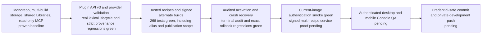

The ownership model is settled. Remaining work includes proving exact provider
delivery, hardening the implemented boundaries, proving the real service
composition, inspecting the Console, and checkpointing only after the full gate
is green.

## One-screen product map

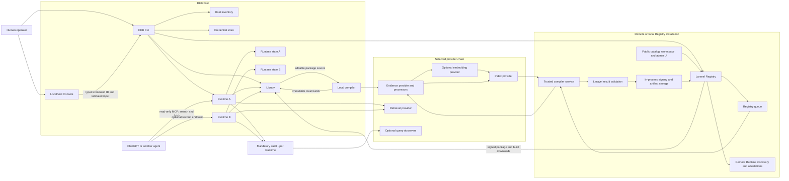

The Console does not implement a second management API. It invokes an
allowlisted CLI operation using structured input and consumes the CLI's JSON
event stream. The CLI, Runtime, compiler, and Registry client therefore share
the same domain operations whether a person uses the terminal or the Console.
The provider group represents reusable implementations in separate trusted
contexts, not one shared server spanning the Registry and every Runtime.

Public interfaces are separated by authority:

| Surface | Purpose | Authority |
| --- | --- | --- |
| Console loopback server | Host management through typed CLI operations | Local Console session/control token |
| Registry catalog API/UI | Browse public and authorized package metadata | Anonymous public access or saved host Registry credential |
| Registry publish/build API | Publish source and request trusted recipes | Scoped team token plus namespace policy |
| Runtime read HTTP | `/api/search`, `/api/retrieve`, `/api/read-targets`, `/api/read` | Read or admin credential by default; anonymous reads require explicit public-read mode |
| Runtime MCP | Remote-agent `search` and `fetch` | MCP bearer credential plus host/origin checks |
| Runtime administration | Binding, Pipeline, refresh, and install orchestration | Separate Runtime-admin credential |
| Exact layer download | One source/Evidence/Retrieval transfer | Short-lived, non-browsing install grant |

## The object model

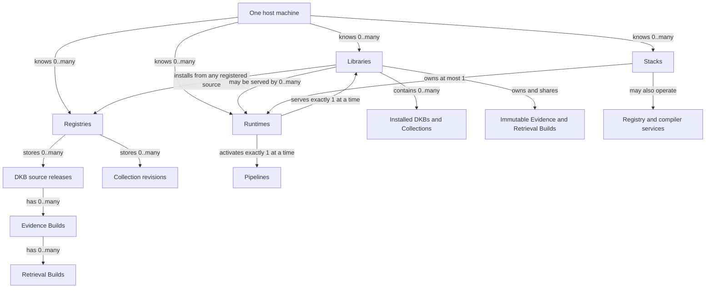

The important cardinality is:

- A **Library** can hold many DKBs and Collections.
- A **Library** can install different releases from different Registries. Its
  default Registry is only a convenience.
- A **Runtime** serves one Library and one Pipeline at a time.
- Many Runtimes can serve the same Library through different Pipelines without
  copying source or immutable builds.
- A **Registry** stores many immutable source versions and multiple trusted
  build variants beneath each source version.
- A **Collection** pins exact DKB source releases. It does not get its own
  Evidence or Retrieval Builds; each member resolves its own compatible chain.

Collection installation tracks why each member is present:

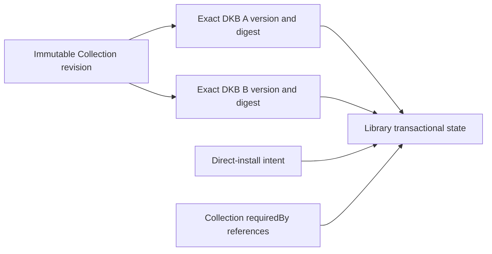

Installing two Collections that share an exact member reuses one package.
Removing a Collection removes only its `requiredBy` reference. A member remains
when another Collection or direct-install intent still requires it; otherwise
its source and Library-local builds are removed transactionally.

## Code ownership map

These arrows are package dependencies, not network calls:

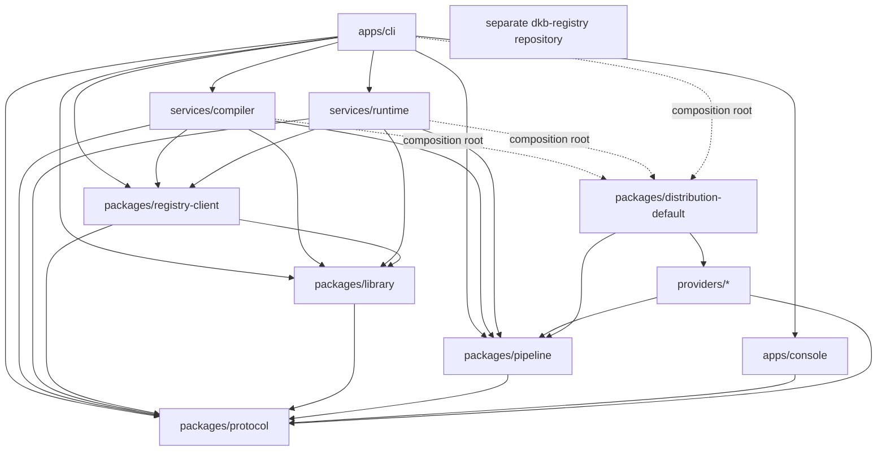

The corresponding operational calls run in the opposite direction where
appropriate:

```mermaid
flowchart LR
    Browser[Console browser]
    ConsoleServer[Console server]
    CLIProcess[Exact bundled CLI process]
    RegistryClientCall[Registry client]
    Laravel[Laravel Registry]
    CompilerService[Trusted compiler service]

    Browser -->|typed operation| ConsoleServer
    ConsoleServer -->|allowlisted spawn| CLIProcess
    CLIProcess --> RegistryClientCall -->|signed HTTP API| Laravel
    Laravel -->|trusted compile job| CompilerService
```

Dependency rules:

- Protocol is the innermost durable contract and has no DKB service dependency.
- Library depends on Protocol, never on providers or the compiler.
- Pipeline defines plugin/provider contracts but contains no concrete provider.
- Providers do not import each other.
- The default distribution is the only package that knows all bundled
  providers and named recipes.
- Compiler and Runtime domain modules receive provider hosts through their
  composition roots; they do not hard-code Docling, TEI, FastEmbed, FAISS, or
  Meilisearch.
- Laravel owns remote users, teams, namespaces, jobs, signing, and publication.
  It does not parse, chunk, embed, index, or serve queries.

### Where to start reading the code

| Question | Owning entry point |
| --- | --- |
| How does the Console run an operation? | [Typed command catalog](../../apps/console/src/server/commandCatalog.ts) and [CLI runner](../../apps/console/src/server/commandRunner.ts) |
| Where are default Pipelines and their required services defined? | [Default distribution](../../packages/distribution-default/src/index.ts) |
| How are plugins discovered and validated? | [Provider host](../../packages/pipeline/src/host.ts), [public SDK](../../packages/pipeline/src/sdk.ts), and [output validators](../../packages/pipeline/src/validation.ts) |
| How is shipped provider code checked? | [Generated integrity receipt and verifier](../../packages/pipeline/src/bundledIntegrity.ts), [verified module loader](../../packages/pipeline/src/bundledPlugin.ts), and [distribution generator](../../scripts/generate-provider-integrity.mjs) |
| How are installable tools packaged? | [Exact-dependency staging](../../scripts/package-distribution.mjs), [candidate preflight](../../scripts/release-package-candidates.mjs), and [private delivery rules](../private-releases.md) |
| What defines durable build identities? | [Protocol build contracts](../../packages/protocol/src/builds.ts) and [resolved profile construction](../../packages/pipeline/src/buildProfiles.ts) |
| Where does compilation run? | [Compiler runner](../../services/compiler/src/pipelineRunner.ts) and [trusted Registry targets](../../services/compiler/src/registryTargets.ts) |
| Where are immutable builds checked and stored? | [Library builds](../../packages/library/src/builds.ts) |
| Who changes an active Runtime? | [Runtime activation owner](../../services/runtime/src/runtime/activation.ts) and [Pipeline switching](../../services/runtime/src/runtime/pipelineSwitch.ts) |
| Who recovers an interrupted Stack start? | [Stack startup journal](../../apps/cli/src/stack/startup.ts); it restores Stack configuration/topology through the existing Runtime gate, never by writing Runtime activation files |
| Who checks Library drift before serving? | [Runtime Library-state validation](../../services/runtime/src/runtime/libraryState.ts) |
| Where is the query-to-evidence audit chain written? | [Audited query operation](../../services/runtime/src/runtime/queryOperation.ts) and [audit persistence](../../services/runtime/src/runtime/queryAudit.ts) |
| How is retained historical Evidence inspected? | [Exact Library Evidence inspection](../../packages/library/src/packageEvidence.ts); this is inert content inspection, not retrieval or signature certification |
| Where is the agent-facing surface? | [Read-only MCP](../../services/runtime/src/mcp/readOnly.ts) |

In the separate `dkb-registry` checkout, begin with `ARCHITECTURE.md`, then
`app/Actions/Registry/`, `app/Services/Registry/Compiler/`, and
`app/Policies/PackageVersionPolicy.php`. The Registry owns authorization and
publication; these files are not a second implementation of the compiler.

### Operational deployment topology

The developer Stack is target-aware. It starts only the provider services
required by the compiler and Runtime targets selected for that Stack.

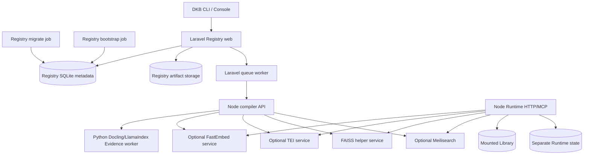

The Laravel image is built from the separate `dkb-registry` repository. The
Compose distribution consumes that image; it does not import Registry source
through a sibling checkout or mount the Docker socket into the compiler.

Stack startup owns a separate recovery journal for its environment, compiler
configuration, Runtime configuration, and previous running topology. A requested
target does not rewrite an existing Runtime's default before activation. On
failure, Stack restores its prior configuration and Library mount only while
the Runtime selection remains unchanged. If an admin response is lost, it
checks the actual committed activation before choosing recovery. It never
restores binding or activation files by copying them. Concurrent operator
changes are preserved, and incomplete restoration retains a protected journal
with an explicit `dkb stack up <name>` recovery instruction.

## Knowledge and build identity

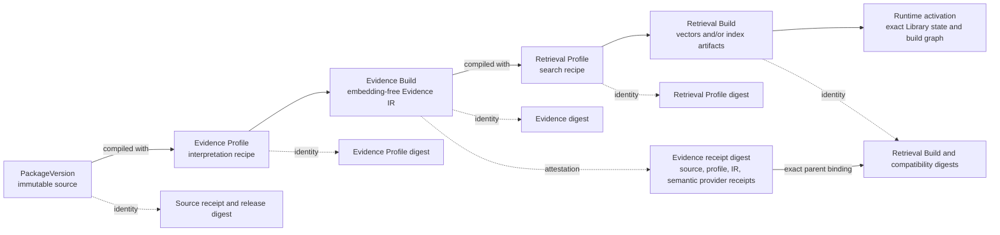

Plain-language definitions:

| Object | Question it answers | Contains |
| --- | --- | --- |
| `PackageVersion` | What knowledge is this? | Immutable source, manifest, source hashes, release provenance |
| Evidence Profile | How should the source be interpreted? | Evidence provider/parser/chunker, ordered processors, options, exact provider identities |
| `EvidenceBuild` | What records did that interpretation produce? | Embedding-free records, source anchors, locators, provenance, catalog, and semantic execution receipt |
| Retrieval Profile | How should that Evidence be searched? | Optional embedder, index, retrieval/fusion providers, options and compatibility fields |
| `RetrievalBuild` | What exact searchable artifacts were produced? | Vectors when needed, packaged or managed-index metadata, Evidence-ID mappings, receipts |
| Runtime activation | What can this endpoint serve right now? | Library generation, active Pipeline, compatibility space, exact build chain per package |

A digest is a fingerprint, not another running component. Recipe fingerprints
identify resolved instructions; build fingerprints identify the output bytes;
compatibility fingerprints say which search space may be opened together.
A signature is different: it binds a receipt to a trusted Registry key. It
does not establish that source text is true, safe, or free of hostile prose.

`EvidenceDigest` fingerprints canonical Evidence IR. The separate
`evidenceReceiptDigest` binds that IR to its source, resolved profile, counts,
and semantic provider receipts. A Retrieval Build binds both the exact Evidence
and its receipt, plus its own semantic provider receipts and artifact manifest.
Timings and cache diagnostics are recorded separately so nondeterministic
measurements do not change knowledge identity.

Profiles are recipes. Builds are stored results. Names are for people; digests
are used for Runtime resolution. A Runtime never activates "latest" or
"closest compatible" artifacts. When no target is requested, the Registry
resolves the exact Evidence/Retrieval chain recorded as that source version's
default build. An explicit target must resolve to one unambiguous compatible
build or fail.

Two target names for the same resolved recipe have the same provider-build and
profile identities. Names remain visible labels but do not alter semantic
identity. A signed build keeps its original label; accepting it under another
name still requires the full exact recipe and compatibility digests. The host
identity regression and Registry alias lookup/deduplication pass, including
actual Node-client consumption of unchanged signed target labels.

## Pipeline and plugin map

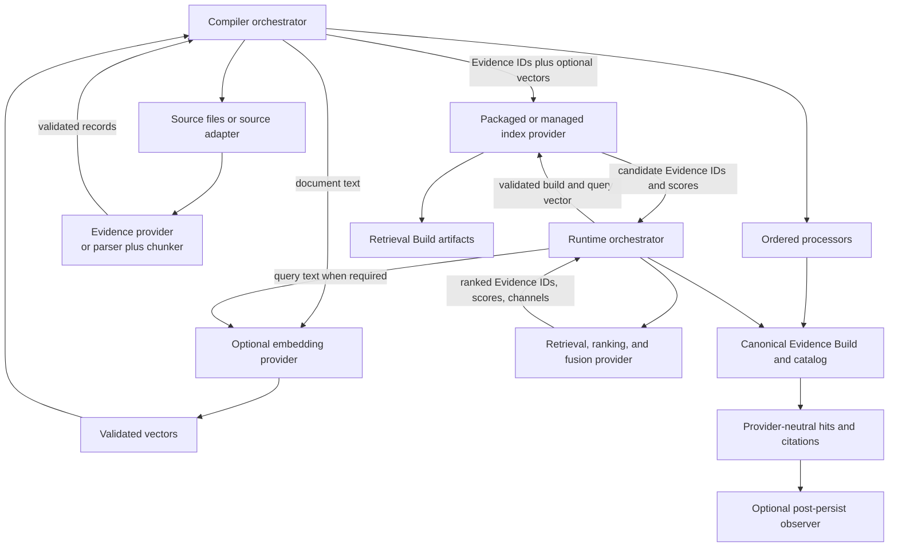

The arrows above show orchestration and contract data, not provider-to-provider
imports or calls. Compiler and Runtime invoke each selected provider; providers
remain independent implementations behind Pipeline contracts.

The bundled Evidence provider consumes package-owned source snapshots, not
manifest-supplied database connections. File and SQLite source hashes describe
the original bytes, while text hashes describe individual records. Source asset
anchors remain stable across rich/plain parsing; page, table, and row locators
describe the particular interpretation. Obsolete worker output or cached records
without the original source hash cannot supply provenance. A trusted custom
provider may implement other source adapters, but uploaded knowledge cannot
choose credentials or live external data through the retired manifest option.

Embedding is optional in the Pipeline contract, compiler, and Runtime catalog.
A lexical-only Pipeline may go directly from Evidence to a compatible
index/retrieval chain. Vector Pipelines use an embedding provider for both
document and query transforms. The focused Runtime catalog proof is green;
lexical-only service composition remains part of the final integrated gate.

Plugin discovery is context-sensitive and fail-closed:

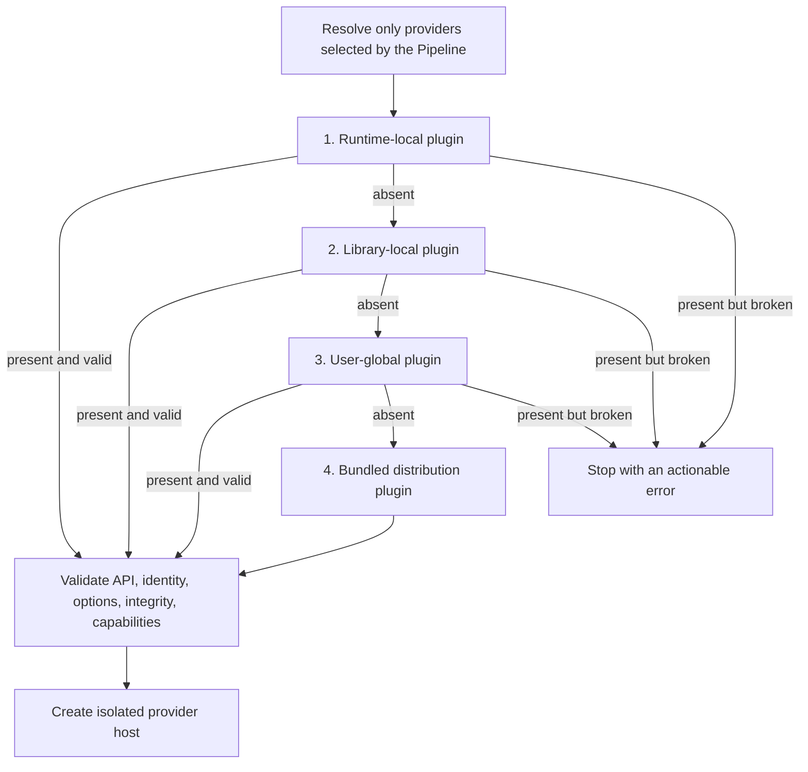

Runtime resolution uses all four levels shown above. Library-root compilation
starts at the Library-local level. A direct DKB compile uses that DKB root as
its local context unless its caller explicitly supplies the enclosing Library
context; it does not silently infer a parent Library. Registry compilation
starts at its trusted compiler context, followed by the operator's global and
bundled providers. Plugins are trusted operator code. Knowledge packages never
carry plugins, configuration, dependencies, or credentials.

The active API-v3 hardening makes `@sjshovan/dkb-pipeline` the author SDK. It
adds typed definition helpers, Standard Schema option validation, strict
provider inputs and outputs, DKB-owned canonical Evidence identities,
generated bundled integrity baselines, resolved execution receipts, conformance fixtures, and
non-mutating query observers.

Bundled provider builds generate `dist/provider.integrity.json`, binding the
plugin identity, explicit shipped-file inventory, and exact declared runtime
dependency closure. Packaging verifies that existing receipt rather than
regenerating it. The distribution holds inert module references, not imported
executable providers. After resolving higher-precedence overrides, the host
checks installed files, dependencies, and literal imports against that receipt
before importing the selected provider. It then combines the verified integrity
identity with validated semantic options and declared external identities when
resolving Evidence and Retrieval Profile digests. Static receipts contain no secrets, live
endpoints, runtime options, or model weights. Filesystem-only local plugins
retain host-computed integrity and do not require a new plugin manifest.

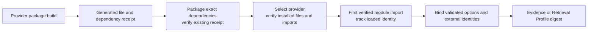

The loader binds its first import to the verified receipt, shares only that
verified module identity, and keeps provider setup, options, and state isolated
per host. It rejects a changed package/dependency identity after loading and
requires a process restart. A literal helper import missing from the receipt
also fails before module execution. Real ESM tests cover pre-selection rebuilds,
unselected throwing providers, broken overrides, concurrent hosts, and helper
drift. These checks do not sandbox arbitrary trusted operator code or certify
computed imports outside the declared contract.

Literal-import inspection uses a pinned Acorn parser, not text matching.
Strings, comments, and regular-expression contents cannot invent dependencies.
Supported TypeScript helpers are stripped with Node's native API before syntax
inspection; execution still requires the host's appropriate Node loader/flag.
Unsupported syntax fails closed. This inspection never executes provider code.

A fresh-install proof exposed ordinary npm dependency drift: `zod` and
`fast-uri` resolved to newer versions than the provider's receipt. The existing
integrity check correctly rejected the installation. Native dependency bundling
is the chosen delivery mechanism for the six deployable provider packages; the
generic SDK remains an ordinary library. Release staging verifies the existing
receipt after dependency installation and never repairs a mismatch by generating
a new receipt. All six providers now pass an offline installation and dependency
tampering test with competing host dependency versions. Inspection uses the
trusted host SDK, not an unverified verifier supplied by a candidate. The
Windows CLI distribution proof now passes with all 15 candidates and all six
installed providers verified. Linux and service-backed proofs remain below.

The bundled catalog currently declares these recipes. This is an availability
of definitions table, not a claim that all services are running or that the
latest lifecycle gate has passed:

| Target | Evidence | Embedding | Index | Retrieval |
| --- | --- | --- | --- | --- |
| `default` / `tei-faiss` | Docling/LlamaIndex | TEI, 384 dimensions | FAISS | Hybrid |
| `tei-faiss-768` | Docling/LlamaIndex | TEI, 768 dimensions | FAISS | Hybrid |
| `fastembed-faiss` | Docling/LlamaIndex | FastEmbed, 384 dimensions | FAISS | Hybrid |
| `fastembed-faiss-768` | Docling/LlamaIndex | FastEmbed, 768 dimensions | FAISS | Hybrid |
| `tei-meilisearch` | Docling/LlamaIndex | TEI, 384 dimensions | Meilisearch | Hybrid |

Named targets live in the distribution or trusted operator configuration, not
in generic Runtime/compiler conditionals. Lexical-only is a supported contract
and fixture path, not a bundled target advertised in this table.

Bundled and local providers use the same API-v3 identity declaration for
canonical external service, image, and model digests. The host validates and
sorts those declarations, merges plugin-wide and provider-scoped identities,
and binds them into the exact provider integrity digest used by Evidence and
Retrieval profiles. Operational endpoints, timeouts, batching, and secret
references remain separate from output-affecting profile options.

## Lifecycle maps

### Publish a Registry release

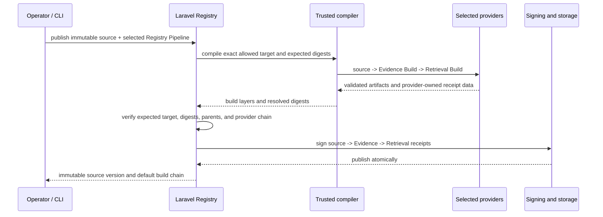

Uploaded source cannot choose plugin code or arbitrary compiler configuration.
The Registry operator advertises allowed recipes. Publication uses the Registry
default unless an authorized publisher selects another advertised recipe.
Implementation source code may be knowledge content; compilation must treat it
as inert input, not execute it as an uploaded plugin or build script.

CLI publication uses a source-only archive writer: compiled local builds,
receipts, `.dkb`, plugins, dependencies, and credentials are excluded before
upload. Normal install archives still contain their verified immutable build
chain. A compiled editable-source regression proves these are distinct archive
purposes and that publication does not mutate the original source.

### Add another build to the same source

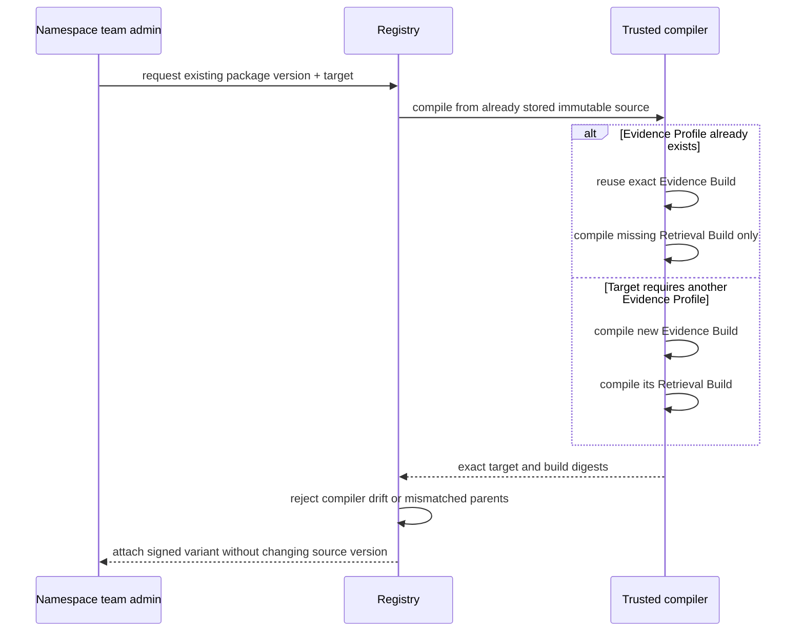

Registry-origin builds are compiled by the Registry's trusted compiler, then
validated and signed by Laravel Registry. A host never uploads a locally produced build into an
existing Registry release. Editable local DKBs may compile locally and are
visibly marked local.

### Install and activate

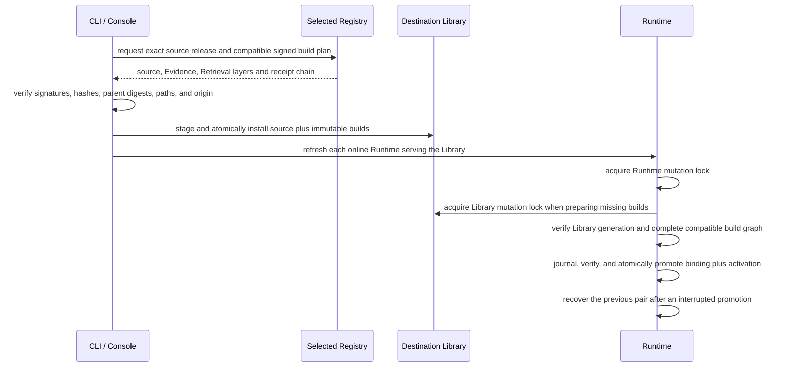

An install names its Registry explicitly. Each installed package retains its
origin and signed digests. The same package identity from another Registry is
accepted only when its immutable signed release digest agrees; a conflicting
origin fails instead of silently winning through Registry priority.

### Query through HTTP, MCP, or CLI

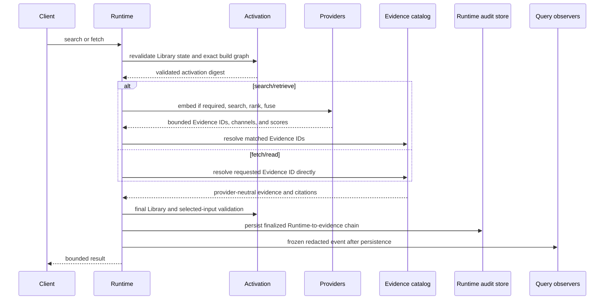

Retrieved evidence is untrusted data, never instructions. Remote MCP remains
exactly `search` and `fetch`. Observers may export telemetry but cannot mutate
the validated evidence, scores, citations, or response.
The current operation awaits observer notification after audit persistence
and before returning, with a one-second delivery budget and an abort signal.
An unfinished asynchronous delivery is not invoked again until it settles;
timeout or cancellation updates observer health without replacing the validated
response. This is not a separate durable background delivery queue. Trusted
in-process code that blocks the event loop cannot be forcibly interrupted.
The final validated snapshot and persisted event are the point-in-time response
boundary. Each request gets one terminal event; observers cannot replace that
outcome or mutate the detached response. A subsequent request rejects later
Library or provider drift. Initial build hashes and receipt
validation remain authoritative; warm reuse checks selected file identity,
metadata, directory membership, and configuration rather than rehashing every
model or index on each query. Host filesystem integrity remains a trust assumption.

Relevance belongs to the selected retrieval provider. MCP no longer suppresses
valid custom-provider results merely because optional keyword diagnostics are
absent. The bundled hybrid provider retains its conservative token-coverage
policy at the provider boundary, consistently across CLI, HTTP, and MCP. Real
MiniSearch queries now prove identical Evidence IDs, package/build chains,
candidates, and citations across those three paths. MCP reports no invented
calibrated confidence for arbitrary provider scores.

The local transport regression uses an actual CLI child process, HTTP requests,
and authenticated MCP calls against a compiled lexical package. Each channel
produces search, fetch, evidence-insufficient, and stale-Library terminal events.
Admitted events match the real activation, exact stored builds, canonical IR,
source hashes, chunk spans, scores, and citation references. Public source
locators are deliberately redacted references; audit verification must not
mistake that privacy boundary for missing provenance. This is a local editable
package proof, not the signed Registry/container lifecycle proof.

### Remote Runtime access

`dkb remote` is a discovery and Registry-attestation catalog. It does not open
sessions, proxy retrieval, install knowledge, or create a second query path.
A hosted endpoint that should be queried is registered in the host Runtime
inventory and addressed through the ordinary `query`, `read-targets`, or `read`
commands, or directly through read-only MCP. The destination Runtime therefore
owns activation verification and the authoritative audit event.


The former `/api/remote/*` Runtime gateway, temporary sessions, proxy retrieval
methods, one-time remote install offers, and retired MCP tool naming have been
removed. Package-boundary checks reject their reintroduction.

## State and storage map

```text
~/.dkb/
├── host.json                         host convenience inventory and defaults
├── config.json                       user-global Pipeline/plugin configuration
├── plugins/                          trusted user-global plugins
├── credentials.json                  saved host Registry credentials
├── console/
│   ├── process.json                  local process/control state (private)
│   ├── activity.sqlite               redacted Console operation history
│   └── autostart*                    optional host scheduler state
└── stacks/<name>/
    ├── stack.env                     ignored local service secrets and ports
    ├── registry/                     Registry DB and artifact storage
    ├── compiler-context/              trusted Registry compiler config/plugins
    ├── compiler-jobs/                 shared compiler job transfer state
    ├── runtime/                       Runtime-owned state root
    └── provider caches/               disposable model/service caches

<library>/
├── dkb.json                          Library manifest
├── dkb-lock.json                     exact logical DKB/Collection resolution
├── <editable-dkb>/                   author-controlled source
│   └── .dkb/builds/                  package-local immutable derived builds
│       ├── evidence/<profile>/<digest>/
│       └── retrieval/<profile>/<digest>/
├── vendor/@namespace/name/           Registry-installed immutable source
│   └── .dkb/builds/                  package-local installed build layers
│       ├── evidence/<profile>/<digest>/
│       └── retrieval/<profile>/<digest>/
└── .dkb/
    ├── state.sqlite                  authoritative applied package state
    └── plugins/                      trusted Library-local plugins

<runtime-state>/
└── .dkb/
    ├── runtime-binding.json          selected Library
    ├── runtime-activation.lock.json  active Pipeline and exact build graph
    ├── runtime-selection.transaction.json
    │                                  crash-recovery journal, present only during promotion
    ├── locks/runtime-mutation.lock   cross-process mutation ownership
    ├── query-audit.sqlite            query and evidence audit chain
    ├── trace.sqlite                  ordered retrieval diagnostics
    └── cache/                         disposable Runtime cache root
```

Libraries logically own installed package builds, while the immutable bytes are
stored beneath each package root rather than in one shared Library build
directory. Libraries do not own an active Pipeline. Runtimes do not own source
or build bytes. The Runtime activation lock contains identities and digests,
not machine-specific build paths. Runtime-admin secrets live in ignored
Stack-local environment state, not in the Registry credential document.

The Registry stores the same logical chain in separately signed layers and also
materializes one derived combined archive for the default download route:

```text
PackageVersion
├── immutable source archive and signed source receipt
├── signed source.inventory.v1        bounded remote source-tree metadata
├── EvidenceBuild[]                   .dkbevidence layers
│   └── RetrievalBuild[]              .dkbbuild layers
└── default combined download         derived .dkbpkg convenience archive
```

## Trust and authority map

| Boundary | Authority and rule |
| --- | --- |
| Source author | Owns source and manifest, but source content is untrusted during compilation and retrieval |
| Local operator | May install trusted filesystem plugins and locally compile editable DKBs |
| Registry operator | Chooses trusted compiler context, allowed recipes, default recipe, services, and signing keys |
| Namespace team admin | May publish source and request additional Registry builds for its namespace |
| Other Registry users | Cannot attach builds to someone else's source; they must fork under their own namespace |
| Compiler | Produces candidate artifacts but cannot self-assert another plugin identity; DKB constructs receipts from loaded code |
| Registry | Verifies compiler result against the queued recipe, then signs immutable source/Evidence/Retrieval chains |
| Library | Verifies packages, receipts, paths, and transactions; filesystem presence alone never means installed |
| Runtime | Serves only an exact valid activation and fails closed on Library, provider, or artifact drift |
| MCP client | Can search and fetch only; it cannot install, compile, publish, mutate, or load plugins |
| Open-source owner | Can modify their own software; DKB guarantees apply only to artifacts passing the declared validation and receipt path |

Registry requests cross two separate rate-limit boundaries. The first protects
credential lookup itself; the second applies the authenticated principal or
install-grant policy for the requested operation:

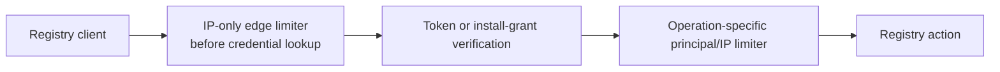

Forwarded client addresses are trusted only from an explicit operator-supplied
proxy allowlist. The default trusts no proxy, and the developer Compose binding
publishes the Registry only on localhost.

## Current implementation status

### Established product shape

- Independently packaged CLI, Console, compiler, Runtime, Protocol, Library,
  Pipeline SDK, Registry client, distribution, and concrete providers.
- PackageVersion -> Evidence Build -> Retrieval Build storage, with immutable
  package-local builds reused by independent Runtime activations.
- Many Runtimes may serve one Library through different Pipelines. A Library
  may install knowledge from multiple Registries.
- The Console invokes typed CLI operations; agents use read-only Runtime MCP.
- The separate Laravel Registry owns authorization, jobs, validation, signing,
  catalog metadata, and release storage.

### Active hardening, not a completed release

| Boundary | Working-tree implementation |
| --- | --- |
| Plugin authoring | API v3 SDK, Standard Schema options, scaffolds for nine provider kinds, and one public conformance suite used by local and bundled providers |
| Provider validation | Explicit protected provenance; detached processor inputs/outputs; dense vector and candidate arrays; DKB-owned canonical Evidence identities; scope, score, lifecycle, and receipt validation |
| Reproducibility | Generated bundled file/dependency receipts; verified selected-only module loading and literal-import inventory; pinned model/service identities; semantic receipts separated from timing/cache diagnostics; exact-dependency release delivery is under proof |
| Registry recipes | Trusted catalog, explicit/default publication target, authorized alternate builds, exact Evidence reuse, queue deduplication, and compiler-drift rejection |
| Signed acquisition | Exact source -> Evidence -> Retrieval chain; Registry transport addresses are separate from retained package origins; local builds cannot replace signed Registry builds |
| Activation | Runtime-owned binding and activation, shared mutation/recovery gate, crash journal, exact graph validation, isolated Runtime caches |
| Query safety | Cold catalog comparison against canonical Evidence IR; warm code/configuration/file drift checks; queued selection reads; final validation before releasing a response |
| Audit | Shared CLI/HTTP/MCP operation, exact Runtime-to-evidence chain, actual scores/channels, frozen post-persist observer events, bounded non-overlapping asynchronous delivery, and per-observer health |
| Console | Typed source-only publication with searchable Registry Pipelines; exact build trust checks; nullable historical audit chains; links to retained exact builds and bounded inert Evidence. Focused tests and production build pass; browser acceptance remains |

Library-root compilation orchestrates editable DKB builds and retains
Registry-origin packages; Collections remain dependency intent and are not
compiled. Fused Evidence providers currently accept record processors;
document/chunk processors require the separate parser/chunker path.

The dormant write queue and remote-query proxy/session surface have been
removed. Remote discovery records endpoints and attestations; actual queries
go directly to the destination Runtime's normal activation and audit gate.
Public package-boundary checks prevent alternate raw query entry points.

### Latest verification snapshot

This table replaces older running totals. It distinguishes local regression
coverage from complete service proof.

| Gate | Latest result |
| --- | --- |
| Workspace TypeScript | Exact `npm run check` passes for all 15 workspaces and Console Vue after the current import-checker and conformance corrections |
| Console production build | Current clean workspace build passes, including publication, build verification, and historical audit/Evidence components |
| Node integration suite | September 13 complete run: 518 passed, zero failures, cancellations, or skips; 397.348 seconds. Includes Runtime/compiler HTTP authority, endpoint-scoped credentials, real CLI/Console credential resolution, and the existing provenance, activation, audit, and SDK regressions |
| Laravel Registry | September 13 full suite: 304 tests / 23,517 assertions passed in 130.122 seconds, including compiler authentication, terminal credential failures, and preserved transient retries/cancellation. Full Pint and PHPStan pass with process-only 1 GiB PHPStan memory. The tested index-only migration still requires live lifecycle proof |
| Latest bounded corrections | Runtime audit/switching set 41/41 plus two isolated catalog tests; provider/capabilities set 64/64; lexical/SDK/provenance/recipe-saving set 64/64. These suites overlap and must not be summed; they are not Docker proof |
| Current transport and Console integration | 28/28 tests pass after the full build: real lexical local/HTTP compilation; CLI/HTTP/MCP query/audit equivalence; MCP authentication and read-only tools; hybrid relevance; Console publication and audit presentation. Exact historical Evidence inspection separately passes six tests |
| Latest real-transport audit | One additional integrated proof passes within the full suite: 12 terminal events from actual CLI, HTTP, and authenticated MCP calls, covering exact local package/build/evidence chains, insufficiency, and rejection after Library removal. Registry signatures and bundled services are not emulated by this proof |
| Source provenance and startup recovery | Five focused Python/public-provider source-policy tests pass, and nine Stack startup/recovery cases pass; all are included in the full suite. Stack cases use real compile/activation/query paths with the Compose subprocess boundary simulated, not a running container |
| Cross-language receipt signatures | Saved Evidence/Retrieval signatures verify with the actual Node Protocol; differential serialization covers 21,906 finite numbers and four nested/Unicode documents |
| Provider identity and model fixtures | Focused 40-test set passes; includes renamed targets, fail-closed overrides, shipped files, and dependency integrity |
| Generated bundled receipts and loading | Nine real ESM loader regressions pass within the complete suite; all six providers pass native offline bundle installation and dependency tampering; trusted-verifier plus private-release set passes 16 tests |
| Selected CPU Evidence model assets | Nine real downloads, 416,666,485 bytes, pass SHA-256 verification; no model weights enter source or knowledge packages |
| Package, documentation, architecture checks | All 15 package inspections passed: 9,485 entries. Dependency graph, boundaries, 18 guidance files, 33 documentation files, and six provider integrity receipts pass. Refreshed Graphify navigation contains 490 nodes / 1,025 edges / 19 communities; it is navigation, not performance evidence |
| Windows/Linux CLI distribution | September 13 exact-archive proof passes on both platforms: 15 archives installed into isolated global prefixes; CLI 0.2.0 runs help/version and initializes unrelated directories; all six provider receipts verify. User global launchers unchanged. Test installs and Linux container removed; deletion of the outer temporary cache copy was blocked, so the Temp cleanup gate remains open |
| Console corrections | Seventeen focused UI tests plus Vue types pass: historical package links are withheld during failed/pending checks, full build digests and numeric sizes remain sortable/filterable, and build requests require a fresh healthy selection. The real isolated fixture produced ten audit events and cleaned up completely. Browser URL policy blocked navigation; no visual approval is implied |
| Live host | Docker 28.3.2 is available. Four distinct local candidate image tags passed disposable startup/activation and all 26 authentication assertions. Own Stack containers/volumes and proof root removed; existing user resources unchanged. Compiler publication, cancellation, and signed lifecycle were not exercised by this smoke |
| Final performance / image / live Console proof | Not yet passed for the current changes |

The repaired Node fixtures now satisfy the strict provider contract and use
local synthetic providers where the test does not require Docker. Production
identity and receipt validation were not weakened.

The new distribution checks exposed and fixed extra prepack output that broke
machine-readable package reports. The integrated rerun also exposed a real
early-timer-wakeup polling defect: Registry retries now wait until their exact
scheduled timestamp and stop at the original operation deadline. A deterministic
regression fails on the old behavior and passes on the correction.

The current warm provider-input guard measured 40.34 ms median over 40 valid
assertions after five warmups, covering 1,608 paths. Configuration was absent
in that isolated context, and package-install activity may have overlapped the
measurement. Continuous bounded workers replace fixed-batch barriers while
preserving every check and the same 32-operation concurrency limit. This is
a loaded-host component measurement, not idle-host speedup evidence or proof
of the end-to-end no-more-than-10% regression gate.

### What the earlier live proof established

An earlier FastEmbed Docker lifecycle in this milestone passed signed source
publication, install, three known-answer queries, hostile-source isolation,
unrelated-query insufficiency, authenticated read-only MCP, public citation
links, uninstall/disappearance, reinstall without compilation, and update.

The subsequent TEI switch rejected differing host/container profile identities
and preserved the previous FastEmbed activation. Focused portability, model,
dependency, receipt, and scope repairs followed. Those repairs need new images
and the same real lifecycle before they can be called proven.

The earlier Windows global-tarball proof passed help, version, and initialization.
The strengthened run adds verification of the installed provider closure and
correctly rejected fresh npm dependency drift for `@dkb/embedding-fastembed`.
The corrected native-bundle path now passes the all-six offline and tamper test
and the complete Windows CLI distribution proof, including installed-provider
verification through the trusted host SDK. The September 13 Windows/Linux
distribution rerun now certifies the current archives. Earlier service-backed
provider-conformance proofs remain historical evidence, not certification of
the current images or signed build lifecycle.

### Remaining implementation and proof before this milestone is complete

The source audit distinguishes these remaining implementation requirements
from the operating proofs below. A passing earlier fixture does not close a
newly demonstrated bypass.

| Boundary | Required correction / evidence |
| --- | --- |
| Registry storage | New paths include namespace, package, version, and unique write identity; storage failures are fatal and rollback is isolated. The 266-test Registry gate verifies this correction |
| Ready-build API | Both PHP ready branches now include the target consumed by the actual Node client; cross-language regressions pass |
| Offline signed activation | Implemented and focused regressions pass: pin origin-fetched keys only after verification; validate exact signed chains at cold admission; reject missing trust or receipts. Offline verification uses last-known key revocation state, not a fresh Registry check |
| Activation promotion | Implemented and focused regressions pass: revalidate the original host and entire prepared graph immediately before promotion, preserving prior activation on drift. Managed rollback discards only a validated newly created exact index; changed ownership or failed cleanup yields an actionable orphan warning, never broad uninstall |
| Retained variants | Verified local variants avoid networking; already-published variants use read/download authority; only absent variants request compilation. Runtime retained, HTTP download alias, and CLI grant regressions pass without rewriting signed target labels |
| Cache and plugin admission | Cache keys include complete embedding integrity and semantic options; reject credentials introduced by schema defaults; dispose failed registrations exactly once; verify definitions without setup; scaffold the actual SDK version. All corrections pass the combined suite |
| Physical execution | Bind managed provider execution to immutable image IDs and pinned model identity. External HTTP image identity remains operator-attested, not proven by `/info`. Actual Compose/image and performance proofs remain required |
| Runtime audit | Focused proofs cover rejected-before-admission records with honest nullable fields, one terminal outcome, mandatory successful persistence, and cross-process IDs. The final validated snapshot and persisted response form the response boundary; observers run afterward and cannot rewrite it. Later drift fails the next request |
| Console completeness | Typed source publication, Registry Pipeline selector, exact historical build/Evidence drill-through, and per-build signature checks pass focused tests; inspect real rendered desktop/mobile flows |
| Pipeline catalog | Resolved-origin requirements, trust-aware coverage, strict versioned client transport, full integrity receipts, and boot-bound compiler identity pass focused tests. Alias resolution must keep exact digest checks and immutable signed labels |
| Registry job cancellation | Laravel authorization, states, and publication guards pass. A bundled-worker gap remains: the Evidence provider does not forward the abort signal; timeout closes only the Node request, then cleanup can race still-running Python writes. Worker termination must be acknowledged before scratch removal or `cancelled`; lost acknowledgment/restart must preserve unresolved state. Current cooperative-provider tests do not prove this |
| Evidence identity scope | Corrected and tested: Evidence digests are scoped beneath PackageVersion, so identical empty IR can coexist without changing canonical bytes or signed artifacts. Index-only migration preserves rows/files; live deployment proof remains |
| Runnable alternate example | The checked MiniSearch example uses explicit parser/chunker provenance and no embedding provider. Public conformance, nonempty retrieval, two Runtimes, scope, corruption rollback, stale-state rejection, removal and retained-build reuse pass through real CLI configuration. It is not a Registry or performance parity proof |
| SDK conformance parity | Corrected and carried through the full Node rerun: complete compatibility/count/readiness checks, overlapping out-of-scope retrieval fixtures, host-owned health identity and strict booleans, and cleanup of only validated newly created managed test indexes after failure |
| Literal import validation | Corrected and focused-proven with pinned Acorn: preserve declared-dependency, path, and shipped-file checks without misreading strings/comments. Node-native supported TypeScript is tested; computed imports remain outside the declared reproducibility guarantee |
| Packaging cancellation | Corrected and carried through the full Node rerun: cancellation reaches native npm commands, cleanup waits for child closure, and the six-provider offline/competing-dependency/tamper proof passes. Its isolated run took 158.96 seconds. The packaging test has a separate 600-second safety budget, not a relaxed compile/query performance gate |
| Service-proof composition | Corrected and nine focused regressions pass: use the actual Stack Library mount and the existing CLI host-image attestation in proof and benchmark contexts. This is fixture-backed wiring evidence, not a claim that Docker ran |
| Source snapshot provenance | Original source hashes are mandatory worker output; rich/plain parsers retain the same asset anchors and avoid hashing once per chunk. Old native caches miss rather than fabricating provenance. Manifest-supplied external database connections and out-of-root SQLite snapshots fail before connection; package-owned snapshots and trusted custom SDK providers remain supported |
| Stack startup recovery | Nine regression cases cover pre-start failure, remount rejection, same-target restart, lost responses after committed activation, concurrent operator changes, recovery on retry, malformed journals, and abandoned-lease contention. Stack uses Runtime-owned validated readers and never restores binding/activation bytes itself. Actual Compose restart/failure proof remains |
| Multi-recipe service harness | Implemented and fixture-tested: three trusted recipes, two Evidence Builds, three Retrieval Builds, exact signed parent chains, changed rich/plain interpretation, concurrent request deduplication, and two independent Runtimes. Actual Docker execution remains pending |
| Performance evidence | Component reports explicitly withhold whole-system promotion. The audit found no retained comparable baseline with three full compilations and complete audited warm queries. A new integrated harness is being added; neither a component result nor a newly established current baseline can retroactively prove the milestone's 10% regression limit |

1. Preserve the September 13 Windows/Linux distribution and complete regression
   checkpoints; rerun them after the next implementation slice. Complete the
   remaining owned Temp cleanup. Candidate delivery still uses the same verified
   archives and fails before publication when a required workspace is private;
   no publication is authorized by this milestone.
2. Current-image HTTP authentication proof passes. Implement acknowledged
   worker cancellation, Library crash recovery, and the signing/retention gates
   listed at the top of this map. Verify exact model consumption and
   host/container profile equality before signed lifecycle proof. Local
   dependency, model, receipt, and scope repairs have passed the integrated
   regression suite; the signed service-backed build-selection proof remains
   the acceptance boundary.
3. Complete alternate-target switch, switch-back, a changed Evidence Profile,
   and concurrent multi-Runtime lifecycle using the transport/origin correction.
   The previous failed switch preserved the prior FastEmbed activation, as
   required.
4. Rerun the service-backed provider, useful-real-corpus, performance, security,
   and read-only MCP proofs against the final images.
   The service harness now includes the changed-Evidence recipe, simultaneous
   independent Runtime, and exact Registry parent-chain assertions. Execute it
   against final images; extend its signed-service audit comparisons across
   CLI/HTTP/MCP and complete explicit 768-dimensional conformance. The passing
   local lexical transport proof is not a substitute for those service checks.
   Measure full compilation and complete warm Runtime queries against a
   comparable baseline; component timings are not substitutes.
5. Carry lexical-only configuration, Runtime-owned Stack binding, and
   crash-journal recovery through service-backed failure/restart proofs.
6. Complete one batched desktop/mobile Console inspection for the new Registry
   Pipeline, build-trust, and Runtime-audit surfaces and correct any material
   responsive or interaction defects.
7. After service-proof fixes, rerun affected regression suites and the final
   release checks: Windows/Linux tarballs, image inspection, performance limits,
   security corpus, package and documentation checks, and DKB-only Temp audit.
8. Audit and push green checkpoints to both private `development` branches,
   excluding machine-local Registry MCP files and unrelated secrets/data.

The latest read-only DKB Temp audit finds twelve older retained/diagnostic
directories plus the timed-out native-install fixture. Guarded cleanup of that
new fixture was also denied and was not retried; it has no detected live owner.
The passing corrected native-install run, isolated Console review fixture, and
fresh Windows distribution proof cleaned up their own new directories.
The final full Node rerun added no retained temporary root. No cleanup denial
was retried. Final cleanup remains bounded to
verified DKB resources; unrelated Temp or Docker data is never in scope.

The local Console root returned HTTP 200 from `http://127.0.0.1:7338` during
this review. This verifies reachability, not authenticated host operations or
downstream service health. Earlier desktop/mobile inspection covered the
existing layouts; final healthy-proof-data confirmation is still pending.
The current isolated Console review could not navigate because the browser's
URL policy blocked it. No alternate browser, port, or indirect workaround was
used. Its servers and private handoff were removed through normal fixture
cleanup; the visual gate remains explicitly unproved.
Docker Desktop's Linux engine is currently unavailable. A normal start crashed
because the inference socket could not be accessed; no reset or socket deletion
was attempted. Earlier diagnostics proved internal Registry
reachability; restoring Docker and rebuilding the changed images are required
before alternate lifecycle, performance, and final image-inspection gates.
No unrelated Docker files were removed to recover the engine.

### Known production hardening after the current proof

These are tracked architectural risks rather than hidden assumptions:

- The current source receipt includes the initial compiler lock, so it is not
  yet a completely build-independent source-only attestation.
- Collection revisions pin exact package releases but are not yet Ed25519
  signed as first-class Registry releases.
- DKB-versus-Collection identity uniqueness is enforced in application logic,
  not one atomic database constraint spanning both object types.
- Only active signing keys are exposed; historical-key verification and a full
  rotation/retirement workflow remain incomplete.
- Registry-to-compiler HTTP now requires an application-level service credential;
  final fresh-image verification remains separate from focused transport tests.
- Remote Runtime verification needs production egress/SSRF policy beyond URL
  validation.
- Transaction rollback cleans staged files, but a hard crash can leave
  unreferenced objects; the Registry has no orphan reconciler yet.

### Structural corrections awaiting integrated proof

- Library-root `build`, `compile`, `serve`, `watch`, and `restore` orchestrate
  editable DKB PackageVersion builds and retain Registry packages;
  `compileCollection()` and activation-free `resolveLibraryRuntimeBuilds()` are
  removed.
- The dormant write queue and remote Runtime proxy/session surface are removed,
  with boundary checks preventing those alternate lifecycle paths from
  returning.
- Provider service identities are supplied by the host composition root as
  immutable OCI digests or local Docker image IDs; compiler and Runtime domain
  code remain Docker-blind.

These corrections have focused coverage. They are not a claim that every
bypass has been eliminated; the final integrated and Docker lifecycle gates
remain authoritative.

## Deliberately deferred

- Cross-Runtime result fusion, comparison scoring, or an agent gateway.
- Write-capable remote MCP or agent-controlled package mutation.
- A public deployment or production-scale Registry topology.
- Automatic plugin distribution through knowledge packages or a plugin
  Registry.
- Public npm/image publication or merging either repository to `main`.

## How to keep this map current

Update this file whenever an accepted change alters ownership, cardinality,
trust, a stored identity, or a lifecycle boundary. Ordinary internal refactors
do not require a diagram change.

For each update:

1. Inspect both repositories' `development` branches and working trees.
2. Verify changed claims in source and tests; do not promote an accepted ADR to
   **Proven baseline** without its acceptance evidence.
3. Update the snapshot commit IDs and date.
4. Update the object, code, lifecycle, storage, and trust maps together when a
   boundary moves.
5. Put the rationale in an ADR and link it here; do not bury decisions in this
   status document.
6. Regenerate the workspace dependency graph and run the boundary and docs
   checks.
7. Refresh Graphify after structural code changes. Use it to detect drift and
   surprising coupling, then verify every inferred relationship in source.
8. Keep unfinished work in **Active working tree** or **Pending proof** until
   the complete gate passes.

Primary verification commands:

```powershell
npm.cmd run graph:check
npm.cmd run boundaries:check
npm.cmd run agents:check
npm.cmd run docs:check
npm.cmd run check
npm.cmd test
npm.cmd run proof:providers
```

Registry verification follows its own `AGENTS.md`: focused Pest tests, the full
suite, static analysis, Pint, and the production frontend build when relevant.

## Related documents

- [Final provider architecture](final-provider-architecture.md)
- [Workspace dependency graph](workspace-dependency-graph.md)
- [Artifact architecture](../artifact-architecture.md)
- [Provider pipeline](../provider-pipeline.md)
- [Library and Collections](../library-and-collections.md)
- [Operations](../operations.md)
- [Security](../security.md)
- [ChatGPT and MCP](../chatgpt-mcp.md)
- [Architecture decisions](../decisions/)
